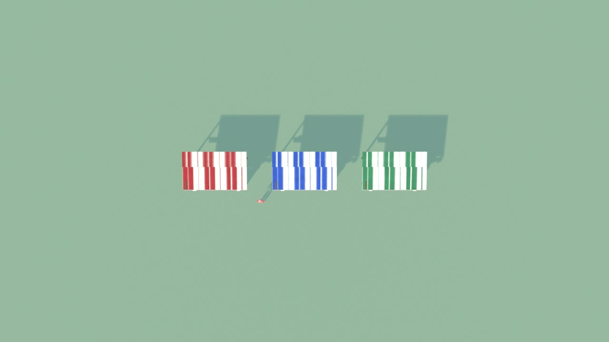
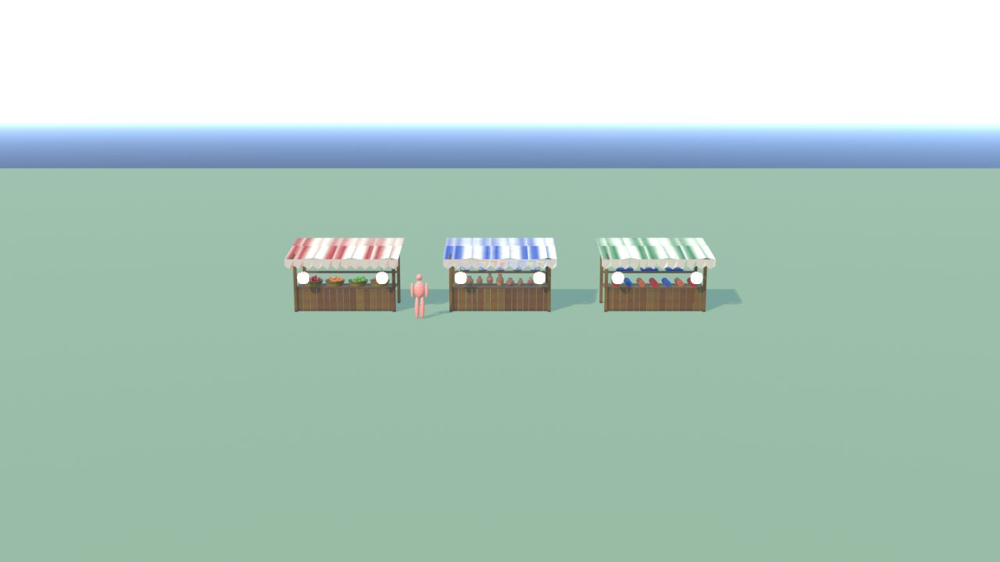
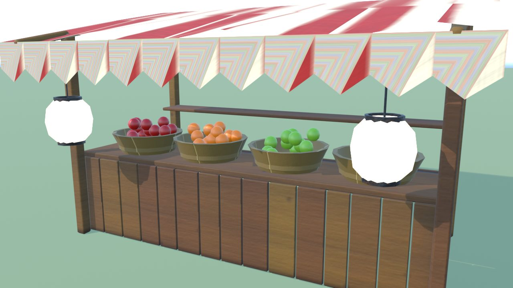
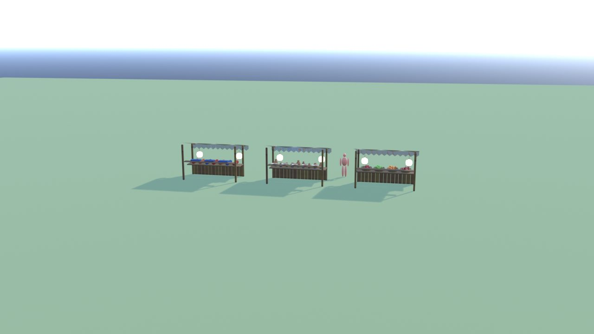
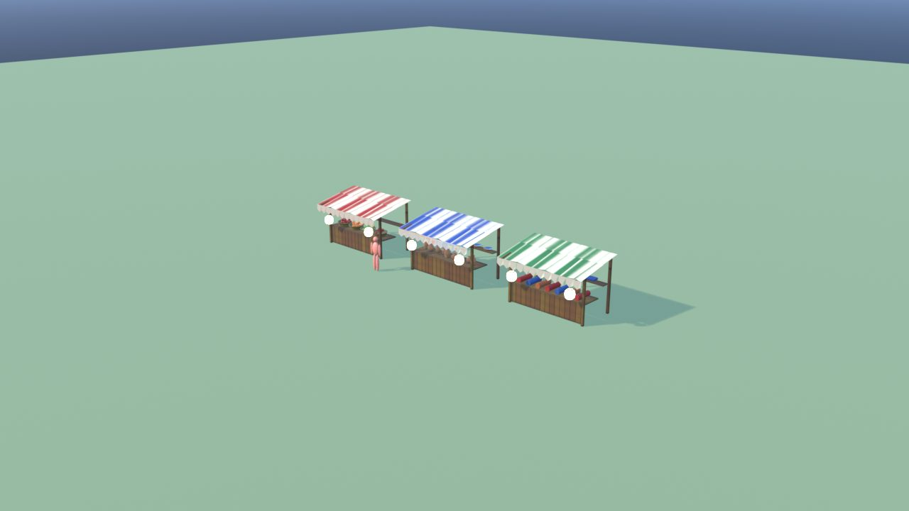
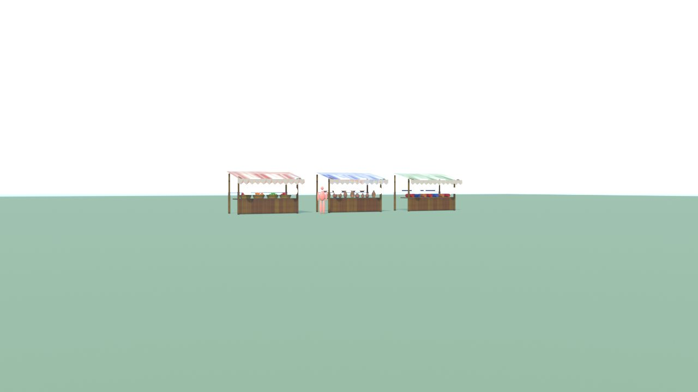

# BancarellaMercato - controllo

Ingombro 16.3 x 2.5 x 2.6 m, 12860 triangoli in 21 pezzi (il piu' grande 2240), 6 collisioni, marcatori: FX_Light_Bancarella1_1, FX_Light_Bancarella1_2, SPOT_Bancarella1, FX_Light_Bancarella2_1, FX_Light_Bancarella2_2, SPOT_Bancarella2, FX_Light_Bancarella3_1, FX_Light_Bancarella3_2, SPOT_Bancarella3.

| Criterio | Voto (1-5) |
|---|---|
| sagoma da lontano | 4 |
| dettagli da vicino | 4 |
| materiali (sporco, usura, colore) | 4 |
| proporzioni col personaggio | 5 |
| qualita' da gioco Roblox | 4 |
| budget (triangoli, misure, collisioni) | 5 |

Cosa manca: niente di grave.

## Anteprime

