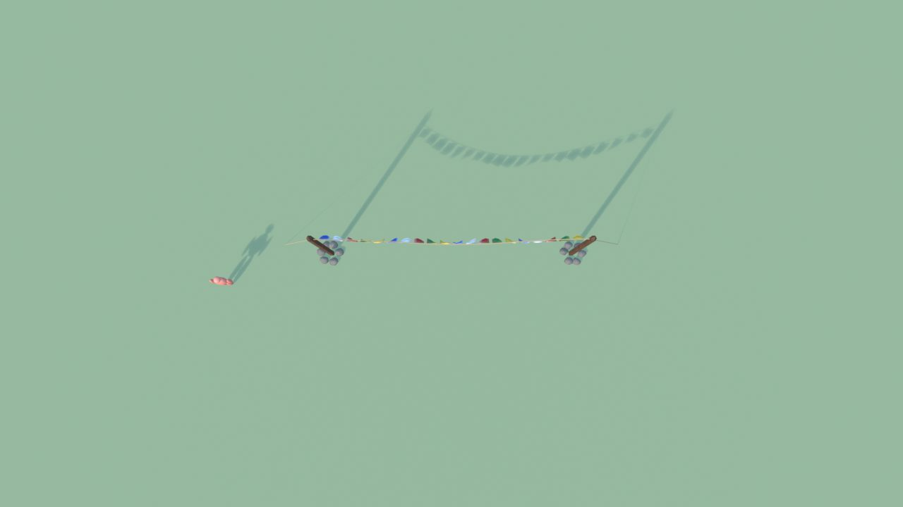
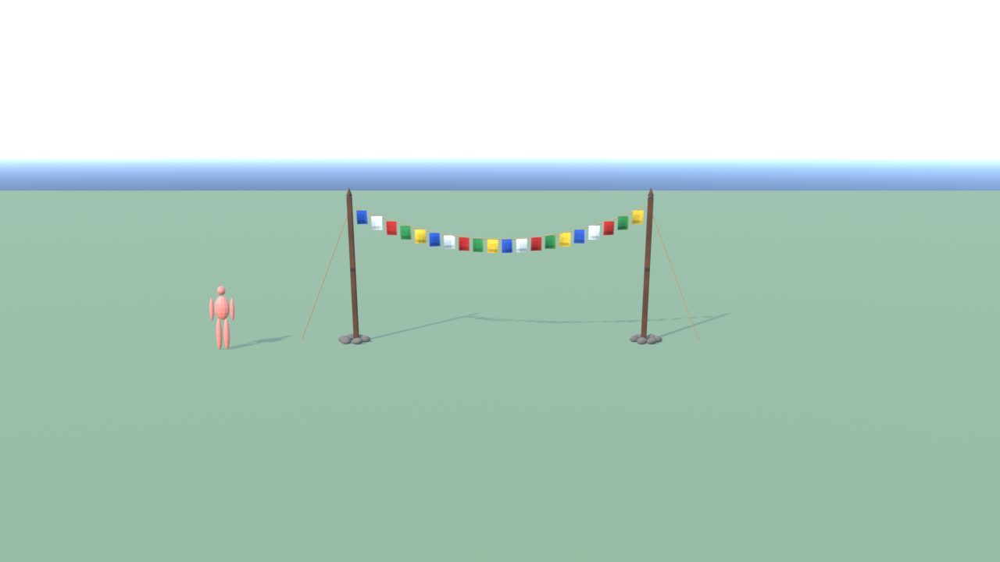
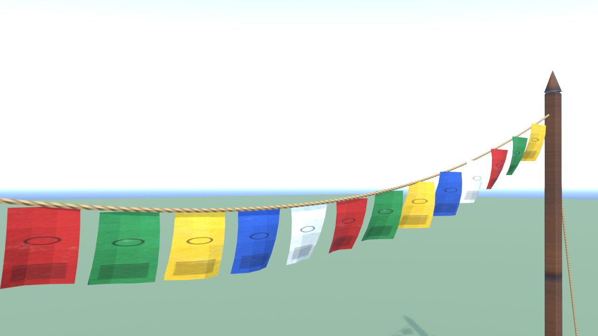
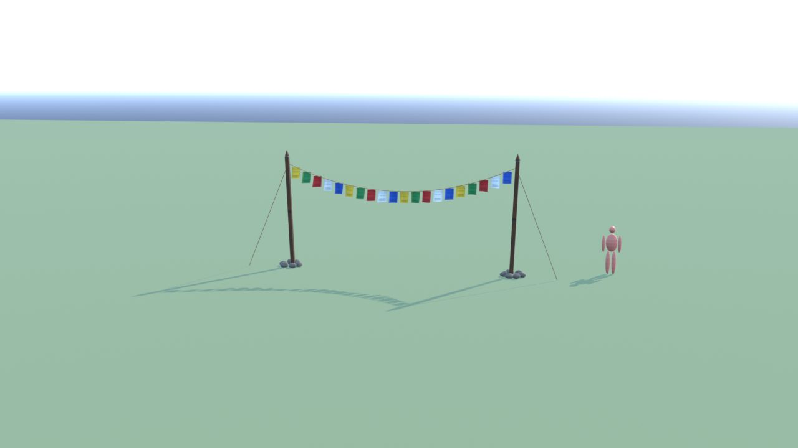
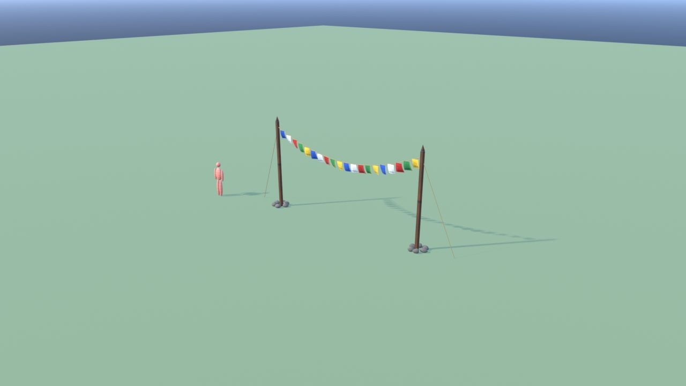
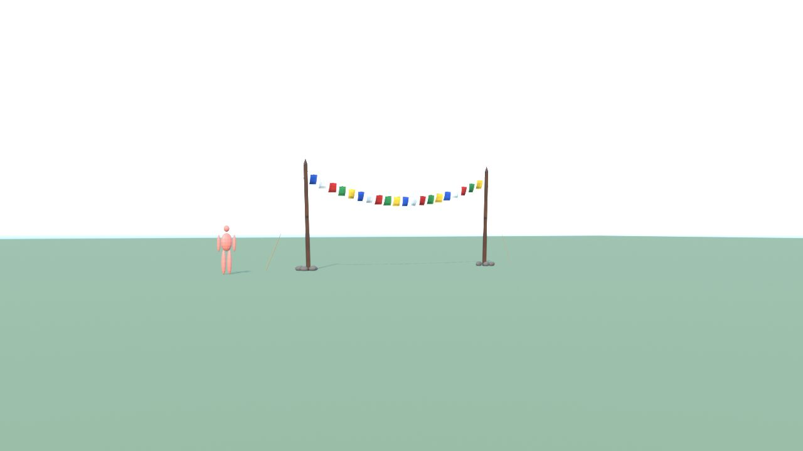

# BandierePreghiera - controllo

Ingombro 11.0 x 0.8 x 4.2 m, 2718 triangoli in 4 pezzi (il piu' grande 1200), 2 collisioni, marcatori: SPOT_Bandiere.

| Criterio | Voto (1-5) |
|---|---|
| sagoma da lontano | 4 |
| dettagli da vicino | 4 |
| materiali (sporco, usura, colore) | 4 |
| proporzioni col personaggio | 5 |
| qualita' da gioco Roblox | 4 |
| budget (triangoli, misure, collisioni) | 5 |

Cosa manca: niente di grave.

## Anteprime

