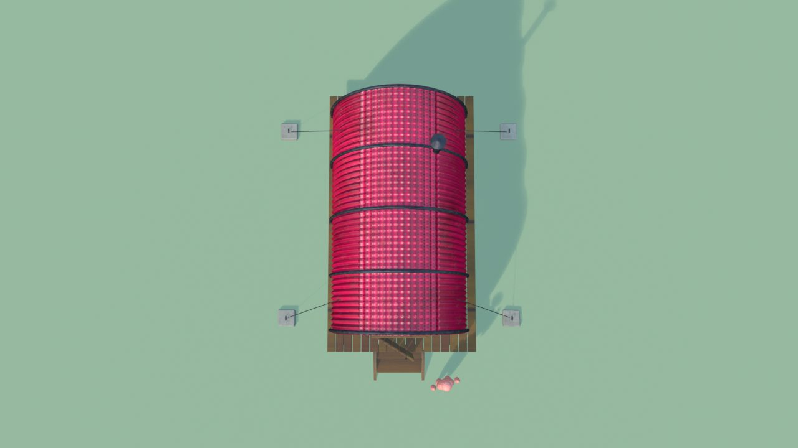
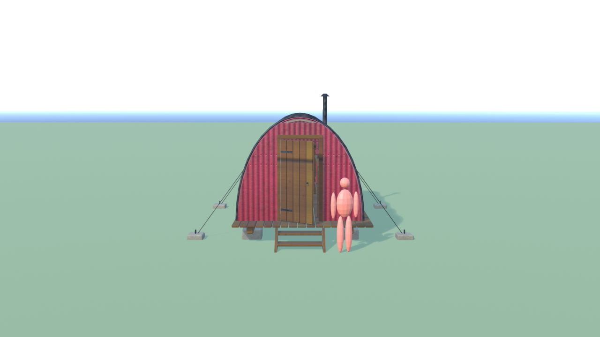
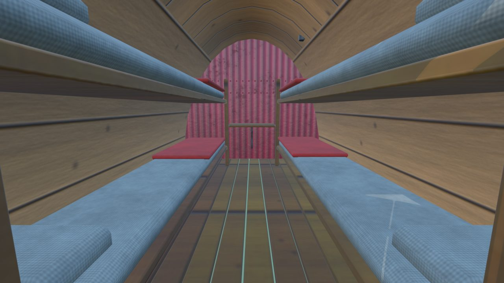
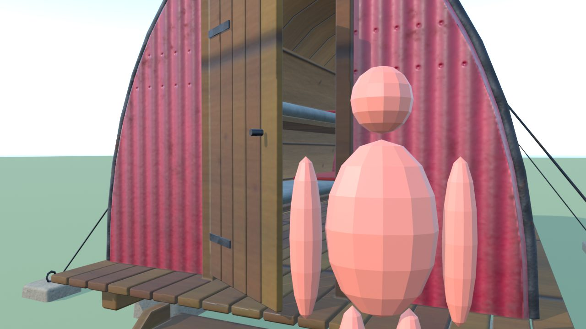
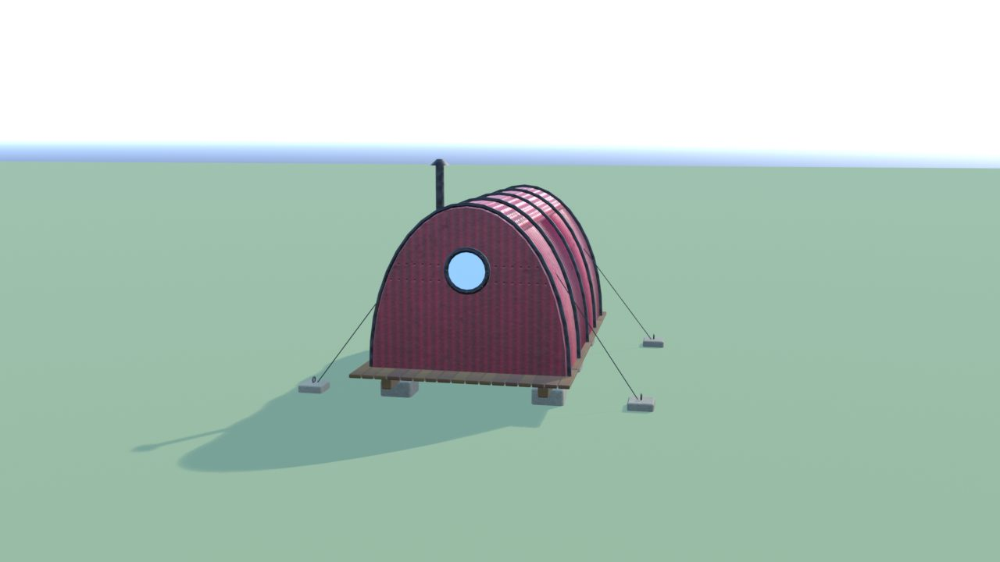
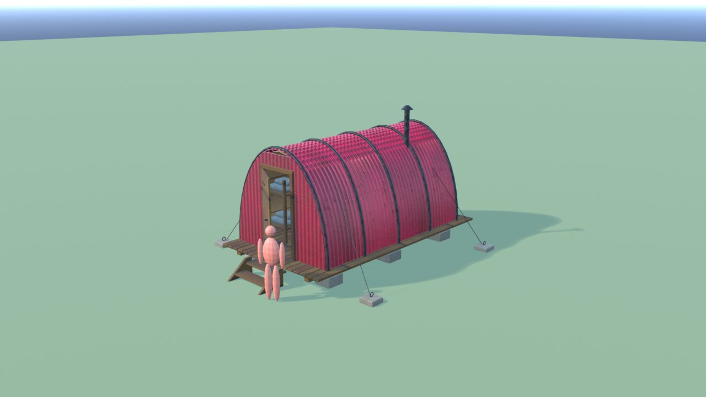
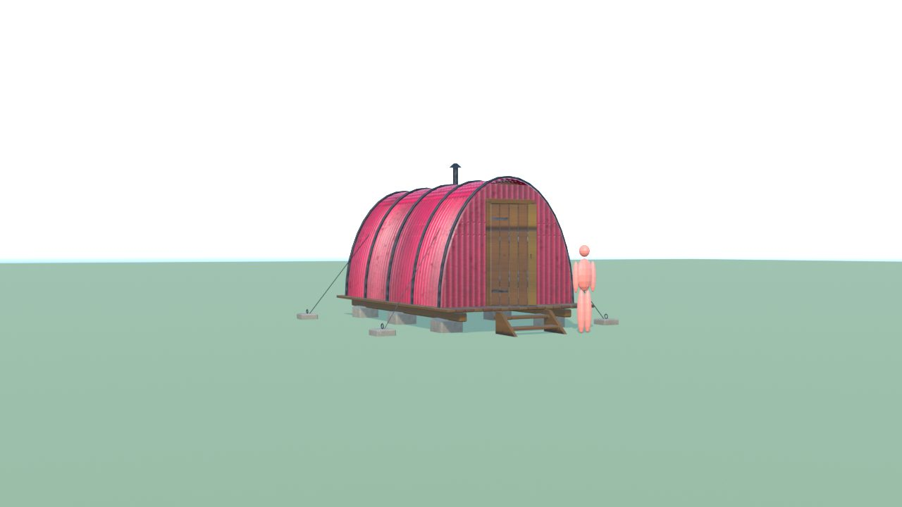

# BivaccoAlto - controllo

Ingombro 5.6 x 6.6 x 3.8 m, 14416 triangoli in 8 pezzi (il piu' grande 9472), 10 collisioni, marcatori: FX_Light_Bivacco, SPOT_Porta.

| Criterio | Voto (1-5) |
|---|---|
| sagoma da lontano | 5 |
| dettagli da vicino | 4 |
| materiali (sporco, usura, colore) | 4 |
| proporzioni col personaggio | 5 |
| qualita' da gioco Roblox | 4 |
| budget (triangoli, misure, collisioni) | 5 |

Cosa manca: niente di grave.

## Anteprime

