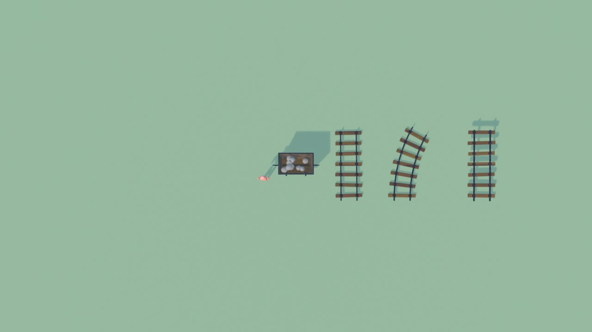
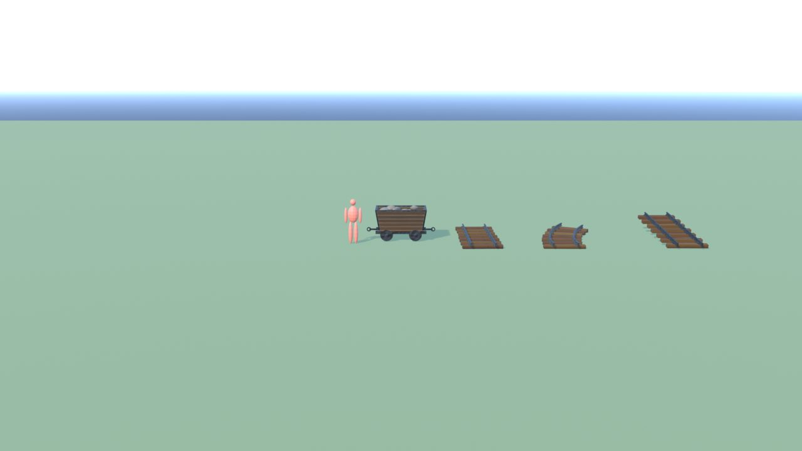
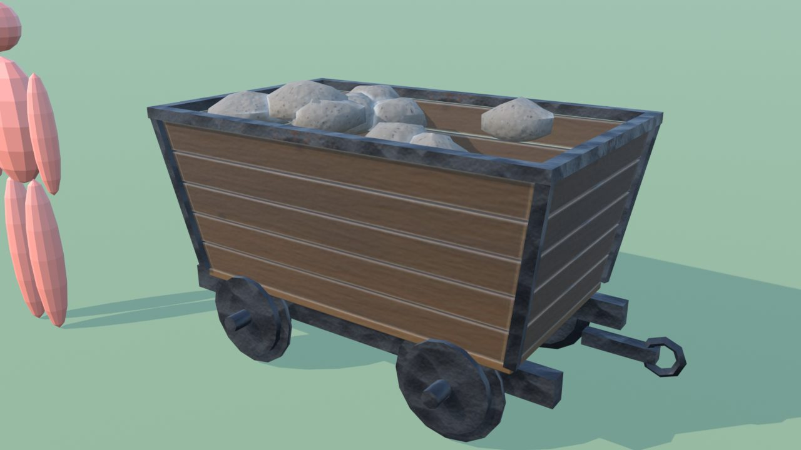
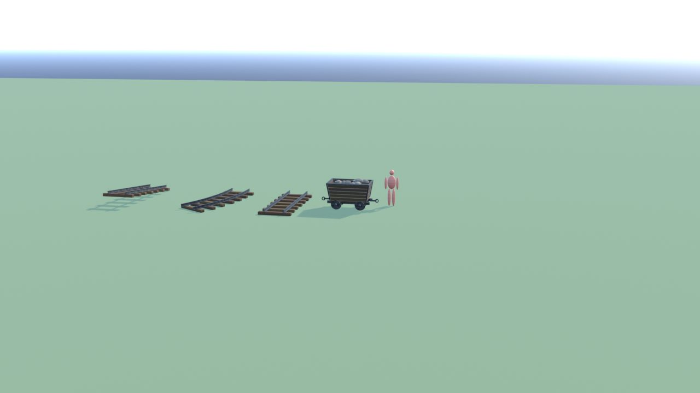
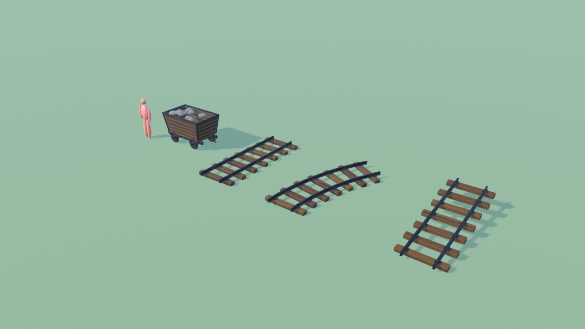
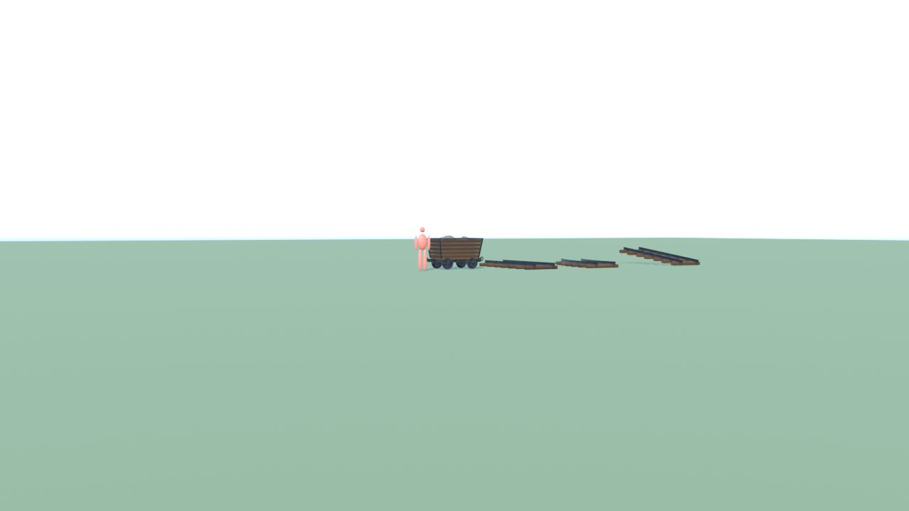

# CarrelloMiniera - controllo

Ingombro 12.6 x 4.3 x 1.4 m, 7624 triangoli in 5 pezzi (il piu' grande 3936), 4 collisioni, marcatori: SPOT_BinariDritto_Inizio, SPOT_BinariDritto_Fine, SPOT_BinariCurva_Inizio, SPOT_BinariCurva_Fine, SPOT_BinariSalita_Inizio, SPOT_BinariSalita_Fine.

| Criterio | Voto (1-5) |
|---|---|
| sagoma da lontano | 4 |
| dettagli da vicino | 4 |
| materiali (sporco, usura, colore) | 4 |
| proporzioni col personaggio | 5 |
| qualita' da gioco Roblox | 4 |
| budget (triangoli, misure, collisioni) | 5 |

Cosa manca: niente di grave.

## Anteprime

