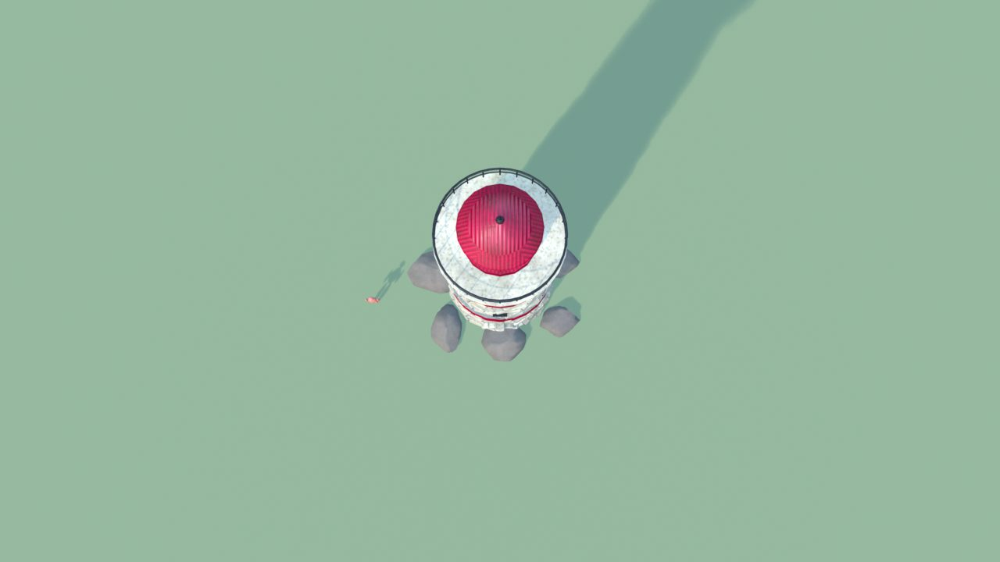
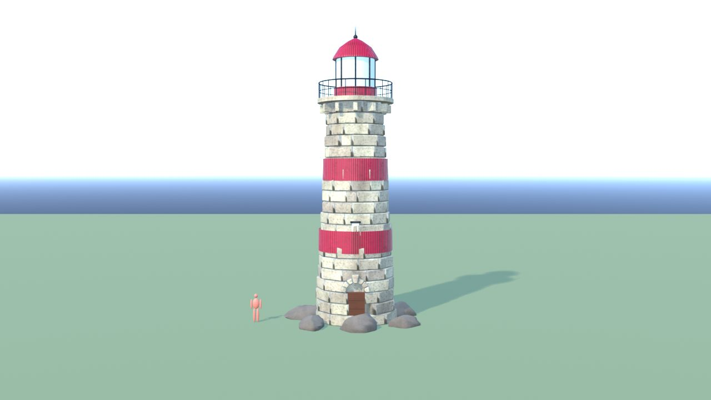
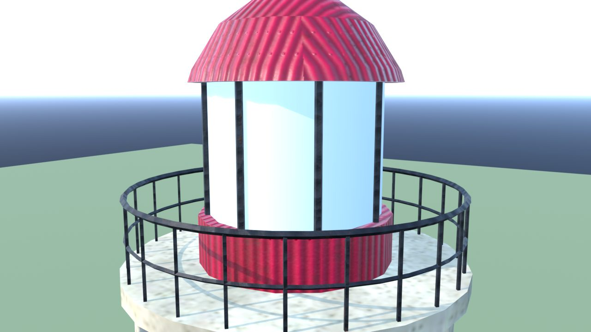
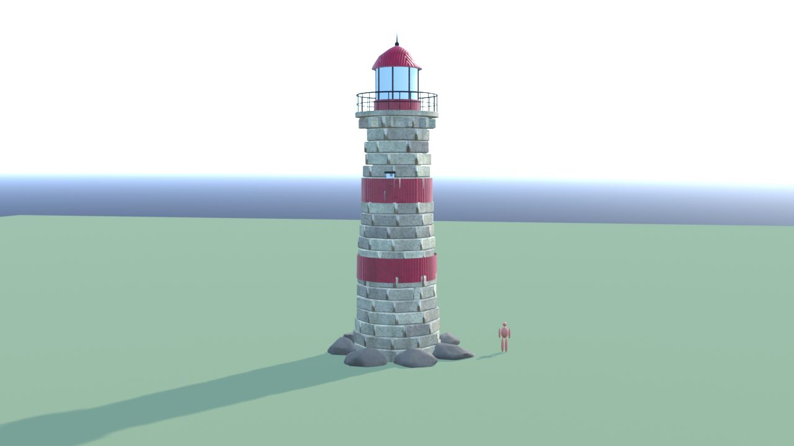
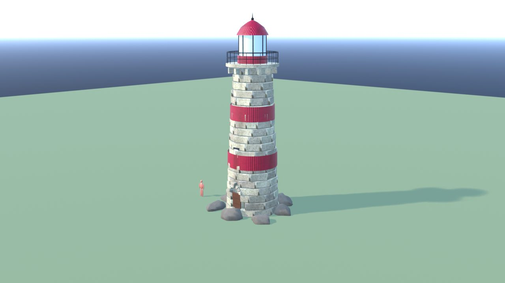
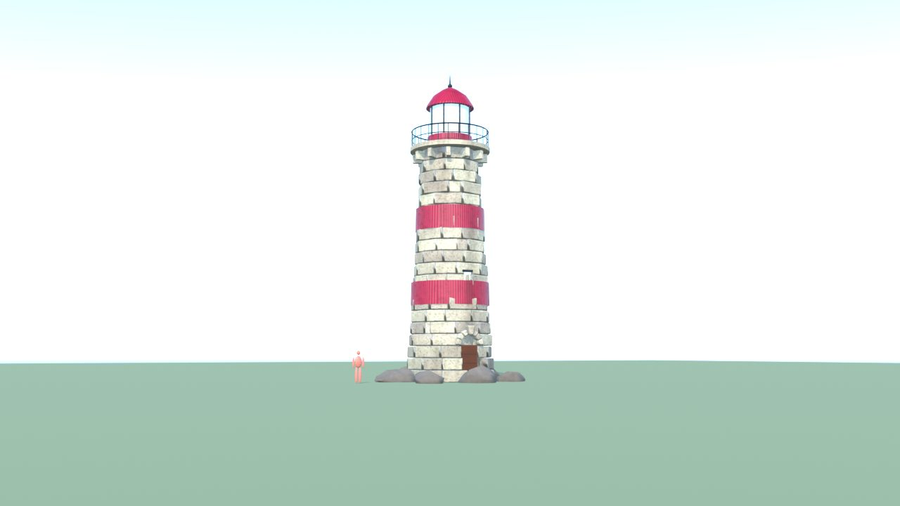

# FaroScogliera - controllo

Ingombro 8.2 x 7.5 x 18.0 m, 9026 triangoli in 7 pezzi (il piu' grande 4378), 3 collisioni, marcatori: FX_Light_Faro, SPOT_Porta.

| Criterio | Voto (1-5) |
|---|---|
| sagoma da lontano | 5 |
| dettagli da vicino | 4 |
| materiali (sporco, usura, colore) | 4 |
| proporzioni col personaggio | 5 |
| qualita' da gioco Roblox | 4 |
| budget (triangoli, misure, collisioni) | 5 |

Cosa manca: niente di grave.

## Anteprime

