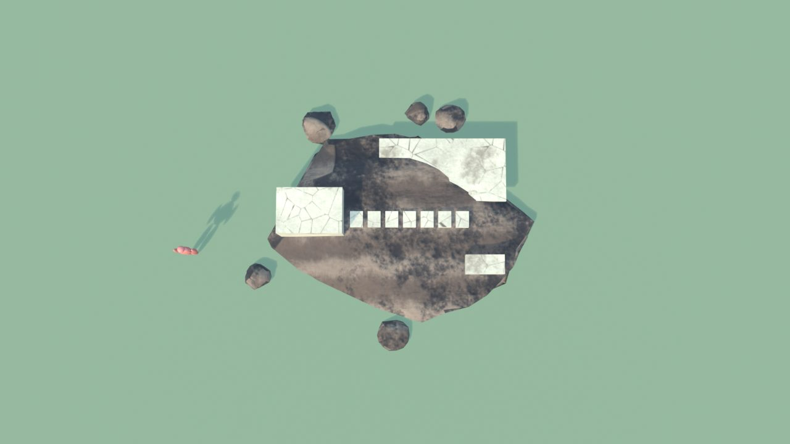
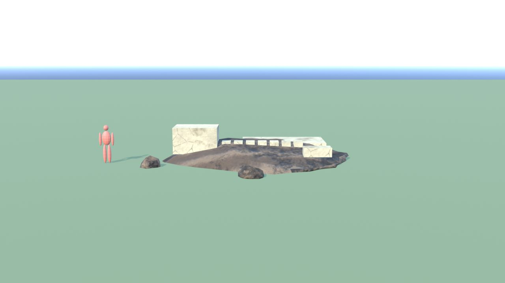
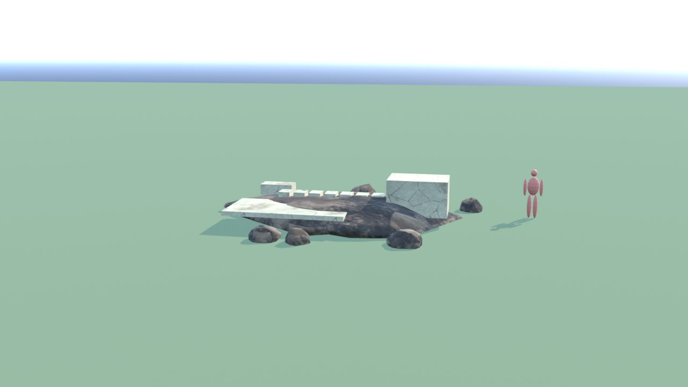
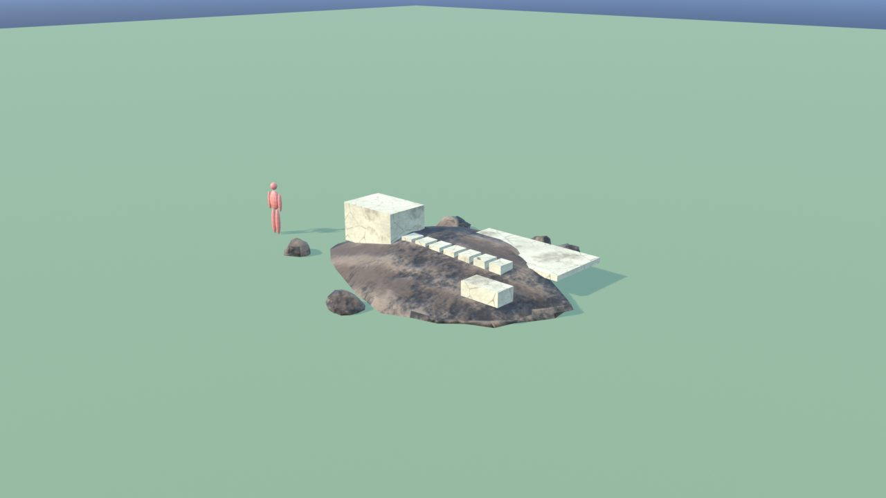
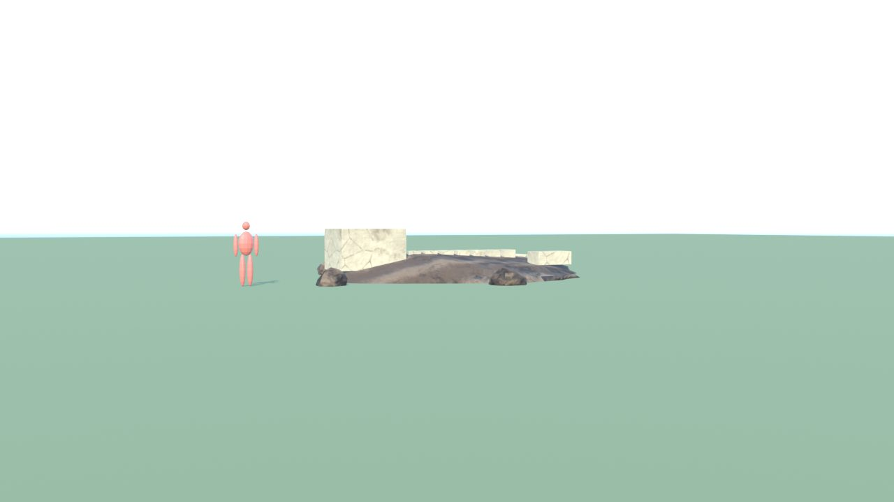

# FossiliDrago - controllo

Ingombro 9.2 x 8.0 x 2.0 m, 2592 triangoli in 2 pezzi (il piu' grande 2472), 1 collisioni, marcatori: SPOT_Fossile_Teschio, SPOT_Fossile_Vertebre, SPOT_Fossile_Artiglio, SPOT_Fossile_Ala.

| Criterio | Voto (1-5) |
|---|---|
| sagoma da lontano | 3 |
| dettagli da vicino | 3 |
| materiali (sporco, usura, colore) | 4 |
| proporzioni col personaggio | 4 |
| qualita' da gioco Roblox | 3 |
| budget (triangoli, misure, collisioni) | 5 |

Sotto 4: i fossili sono Meshy (segnaposto); qui solo la lastra

Segnaposto (Meshy, vedi MESHY_PROMPT.md): PLACEHOLDER_Fossili

## Anteprime

