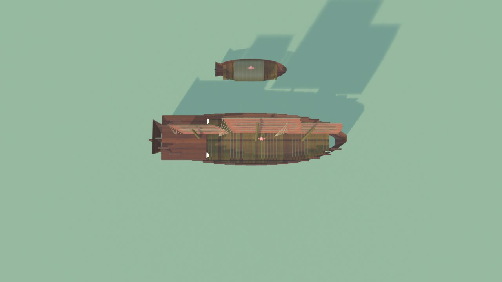
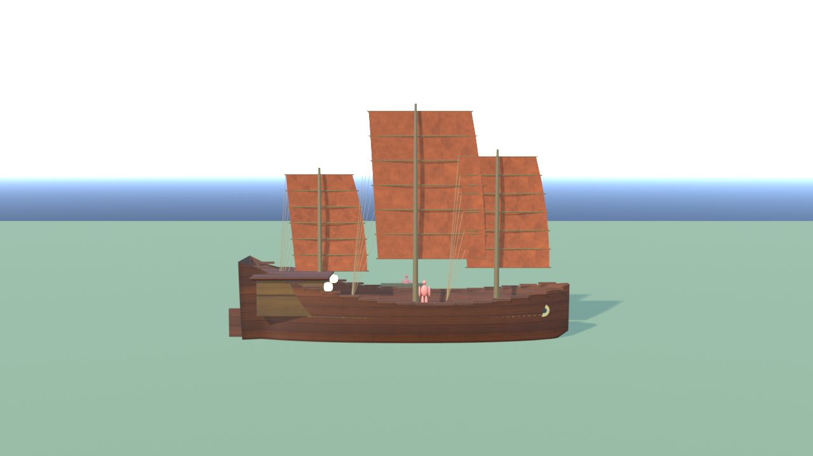
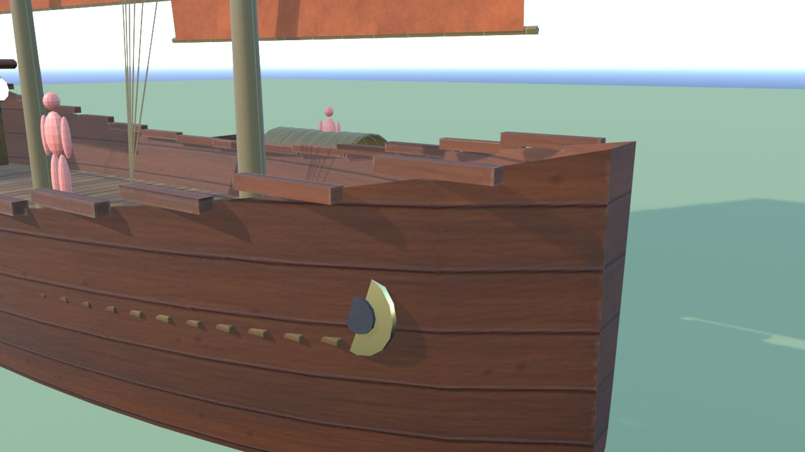
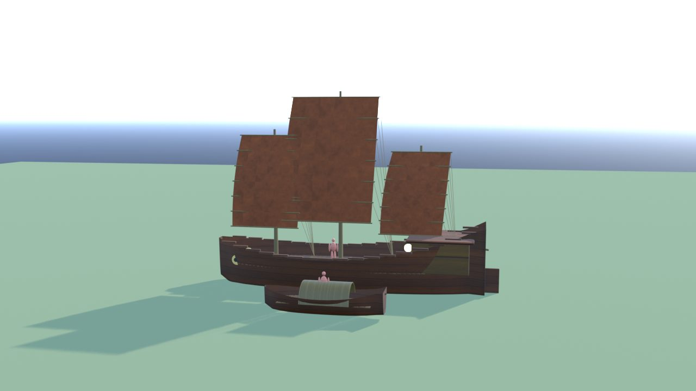
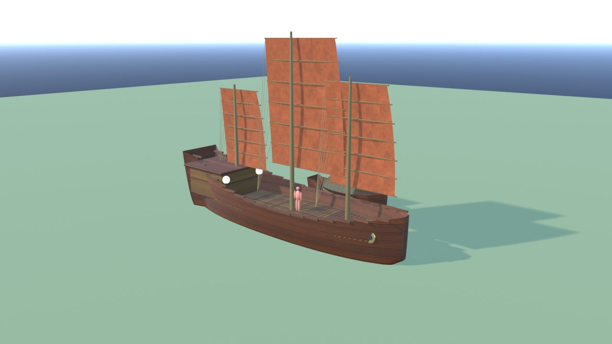
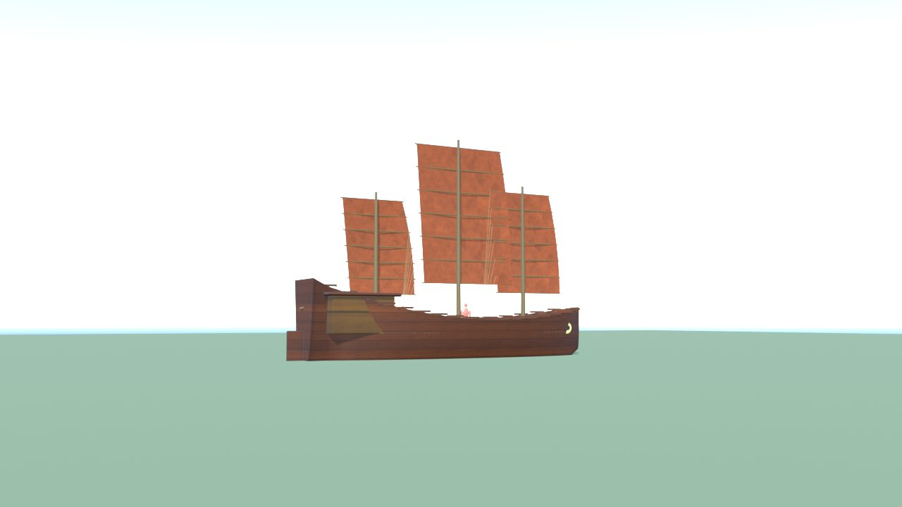

# Giunca - controllo

Ingombro 18.9 x 10.7 x 13.8 m, 7434 triangoli in 13 pezzi (il piu' grande 2332), 4 collisioni, marcatori: FX_Light_Giunca1, FX_Light_Giunca2, SPOT_Ormeggio_Giunca, SPOT_Ormeggio_Sampan.

| Criterio | Voto (1-5) |
|---|---|
| sagoma da lontano | 5 |
| dettagli da vicino | 4 |
| materiali (sporco, usura, colore) | 4 |
| proporzioni col personaggio | 5 |
| qualita' da gioco Roblox | 4 |
| budget (triangoli, misure, collisioni) | 5 |

Cosa manca: vele senza trasparenza; la giunca va messa con la linea di galleggiamento a quota 0 (lo scafo scende a -1,2 m)

## Anteprime

