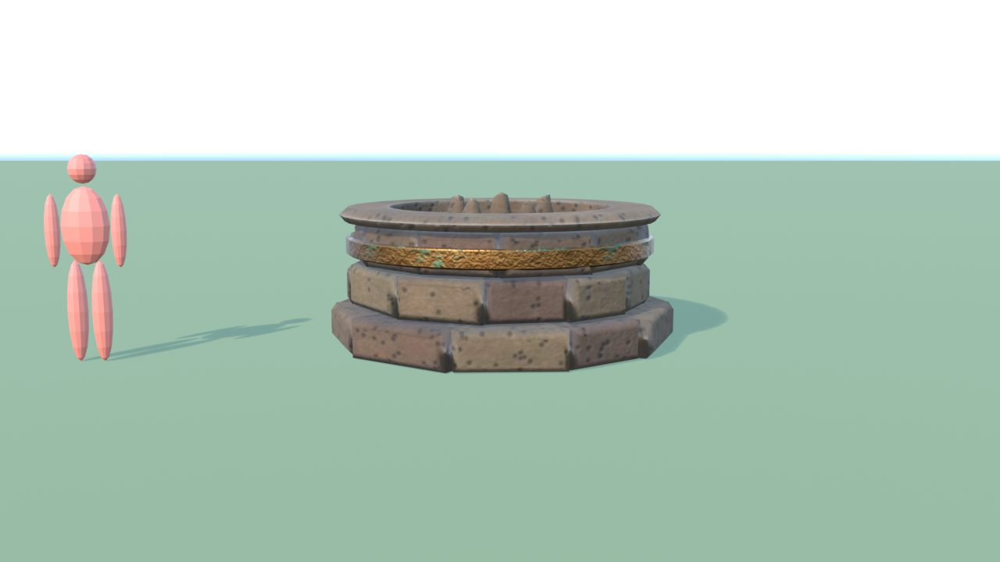
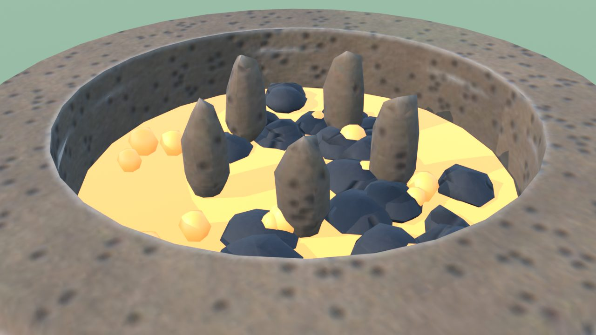
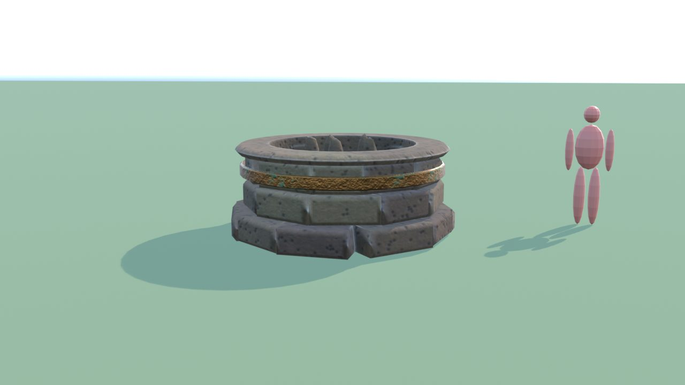
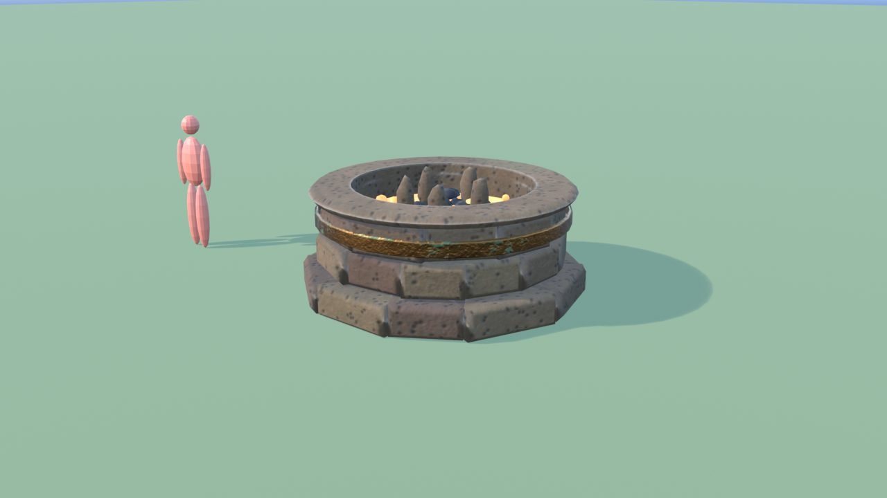
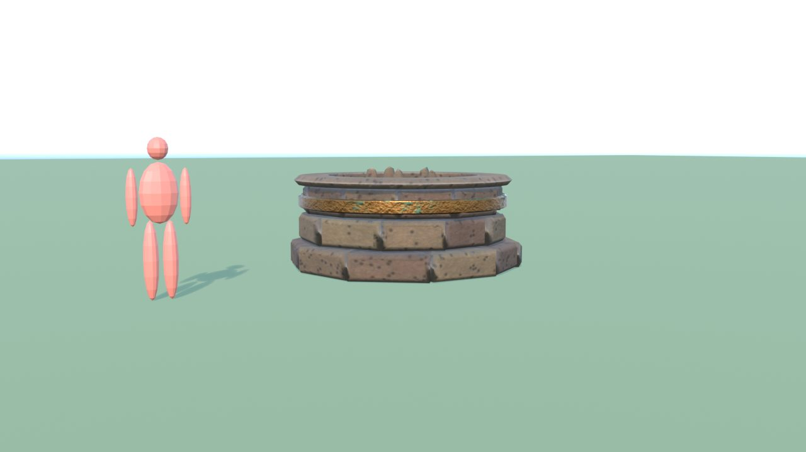

# Incubatrice - controllo

Ingombro 3.1 x 3.1 x 1.3 m, 4140 triangoli in 4 pezzi (il piu' grande 1664), 2 collisioni, marcatori: SPOT_Uovo, FX_Fire_Incubatrice, FX_Light_Incubatrice.

| Criterio | Voto (1-5) |
|---|---|
| sagoma da lontano | 4 |
| dettagli da vicino | 4 |
| materiali (sporco, usura, colore) | 4 |
| proporzioni col personaggio | 4 |
| qualita' da gioco Roblox | 4 |
| budget (triangoli, misure, collisioni) | 5 |

Cosa manca: niente di grave.

## Anteprime

