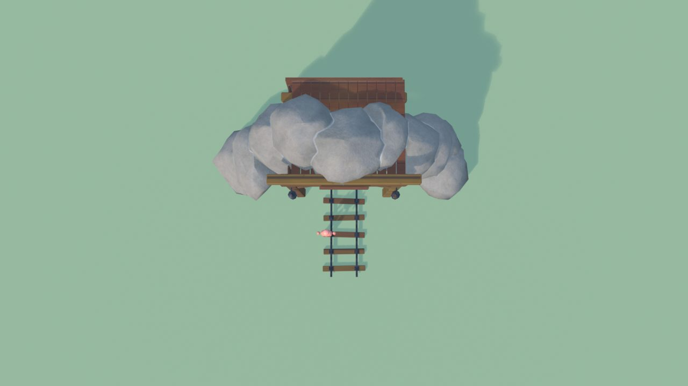
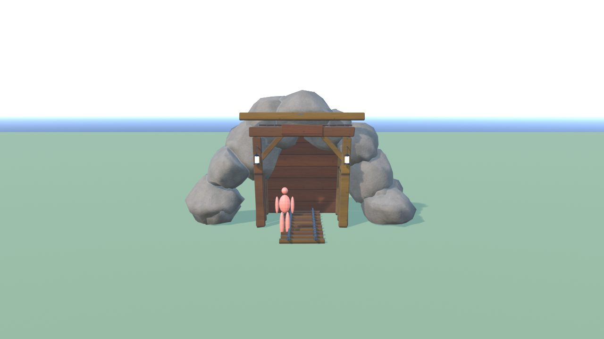
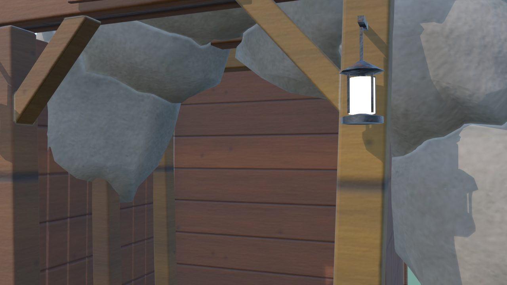
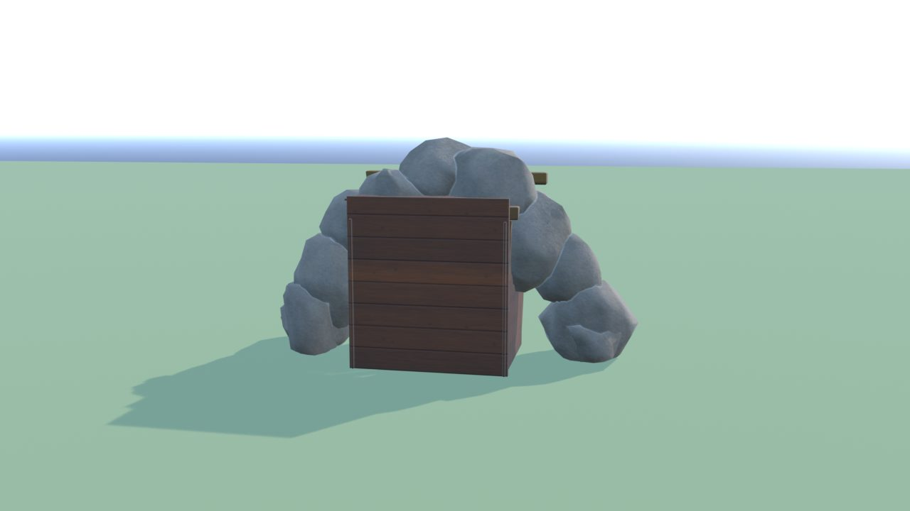
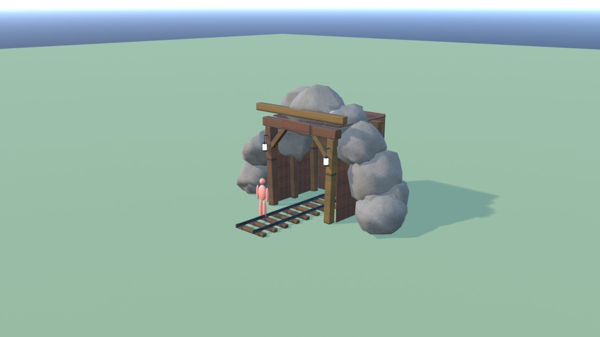
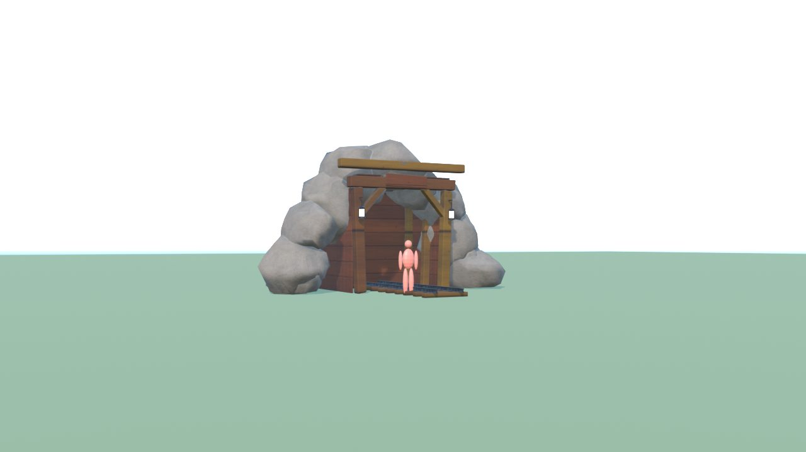

# IngressoMiniera - controllo

Ingombro 9.0 x 6.2 x 5.4 m, 7504 triangoli in 7 pezzi (il piu' grande 2816), 6 collisioni, marcatori: FX_Light_Lanterna1, FX_Light_Lanterna2, SPOT_Galleria.

| Criterio | Voto (1-5) |
|---|---|
| sagoma da lontano | 4 |
| dettagli da vicino | 4 |
| materiali (sporco, usura, colore) | 4 |
| proporzioni col personaggio | 4 |
| qualita' da gioco Roblox | 4 |
| budget (triangoli, misure, collisioni) | 5 |

Cosa manca: la roccia attorno va unita al Terrain della montagna

## Anteprime

