# IsolaDraghi - controllo

Ingombro 708.3 x 612.3 x 270.1 m, 369158 triangoli in 119 pezzi (il piu' grande 17784), 100 collisioni, marcatori: SPOT_Posatoio2, SPOT_Posatoio3, SPOT_Posatoio4, SPOT_Posatoio5, SPOT_Posatoio6, SPOT_Posatoio7, SPOT_Posatoio8, FX_Fire_Roccia, FX_Light_Roccia, SPOT_Statua_Roccia, FX_Fire_Gelo, FX_Light_Gelo, SPOT_Statua_Gelo, FX_Fire_Cosmico, FX_Light_Cosmico, SPOT_Statua_Cosmico, FX_Fire_Tempesta, FX_Light_Tempesta, SPOT_Statua_Tempesta, FX_Fire_Eclissi, FX_Light_Eclissi, SPOT_Statua_Eclissi, FX_Fire_Fulmine, FX_Light_Fulmine, SPOT_Statua_Fulmine, FX_Fire_Ossa, FX_Light_Ossa, SPOT_Statua_Ossa, FX_Fire_Gas, FX_Light_Gas, SPOT_Statua_Gas, SPOT_TestaDrago_Sx, SPOT_TestaDrago_Dx, FX_Fire_Palco1, FX_Fire_Palco2, SPOT_Domatore, FX_Fire_Altare, SPOT_Altare, SPOT_Posatoio1, SPOT_Cascata1, SPOT_Cascata2, SPOT_Cascata3, SPOT_Cascata4, FX_Fire_Sentiero1, FX_Fire_Sentiero2, FX_Fire_Sentiero3, FX_Fire_Sentiero4, FX_Fire_Arrivo1, FX_Fire_Arrivo2, FX_Fire_Arrivo3, FX_Fire_Arrivo4, SPOT_Arrivo, FX_Light_Arrivo, SPOT_PosatoioIsola1, SPOT_PosatoioIsola2, SPOT_PosatoioIsola3, SPOT_PosatoioIsola4, SPOT_PosatoioIsola5.

| Criterio | Voto (1-5) |
|---|---|
| sagoma da lontano | 4 |
| dettagli da vicino | 4 |
| materiali (sporco, usura, colore) | 4 |
| proporzioni col personaggio | 4 |
| qualita' da gioco Roblox | 3 |
| budget (triangoli, misure, collisioni) | 4 |

Sotto 4: le 8 statue sulle torri, le due teste del portale e le corna dell'altare sono segnaposto (Meshy): finche' non ci sono la qualita' resta 3; il prato da molto lontano mostra ancora la ripetizione della texture (in Studio meglio il Terrain Grass sotto o un Decal)

Segnaposto (Meshy, vedi MESHY_PROMPT.md): PLACEHOLDER_Arena_Statua_Roccia, PLACEHOLDER_Arena_Statua_Gelo, PLACEHOLDER_Arena_Statua_Cosmico, PLACEHOLDER_Arena_Statua_Tempesta, PLACEHOLDER_Arena_Statua_Eclissi, PLACEHOLDER_Arena_Statua_Fulmine, PLACEHOLDER_Arena_Statua_Ossa, PLACEHOLDER_Arena_Statua_Gas, PLACEHOLDER_Arena_TestaDrago_Sx, PLACEHOLDER_Arena_TestaDrago_Dx, PLACEHOLDER_CornaAltare

## Anteprime
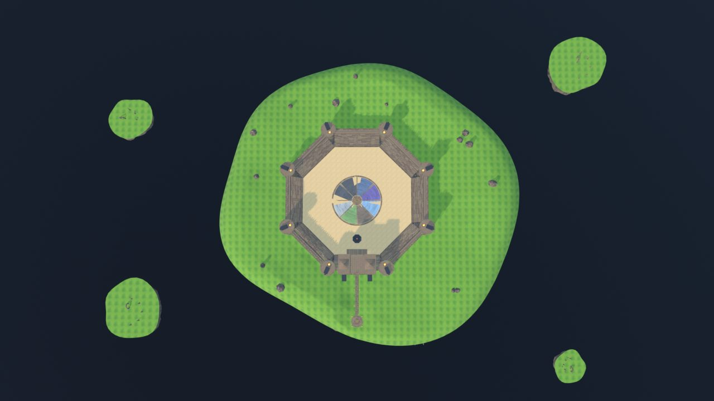
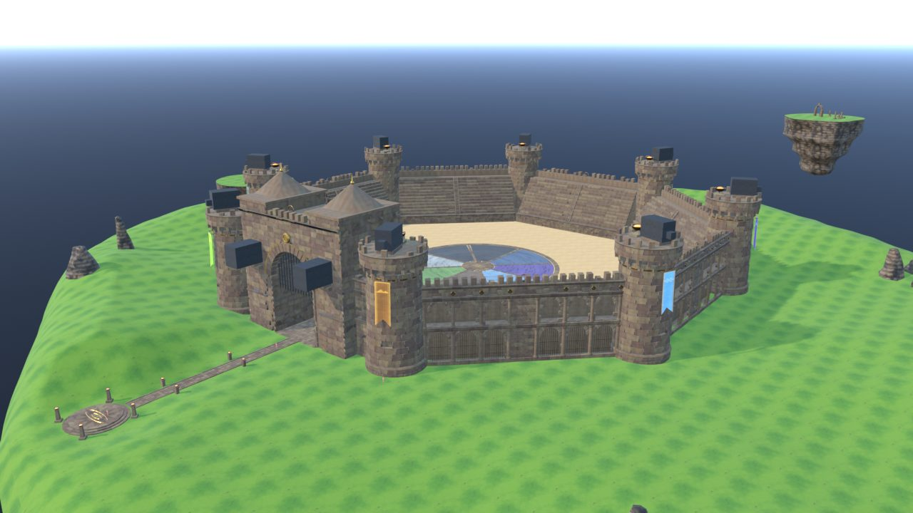
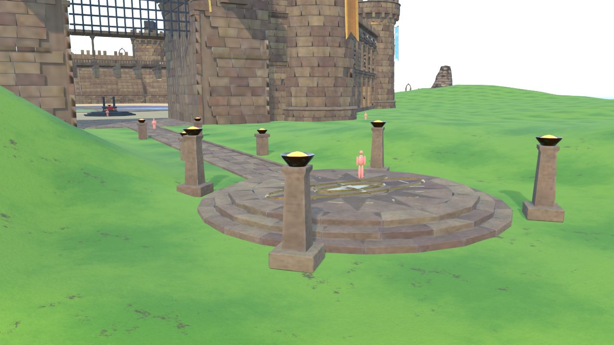
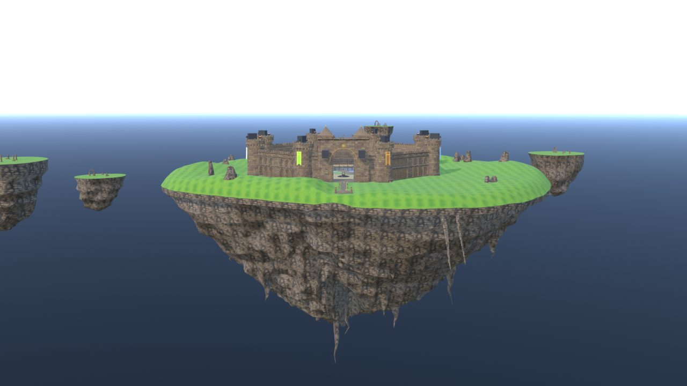
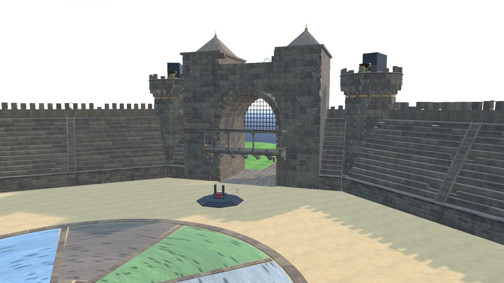
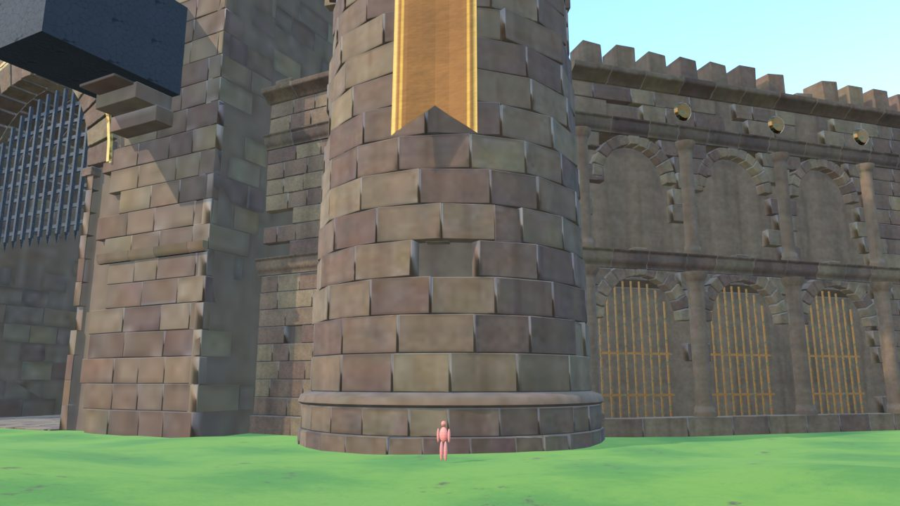
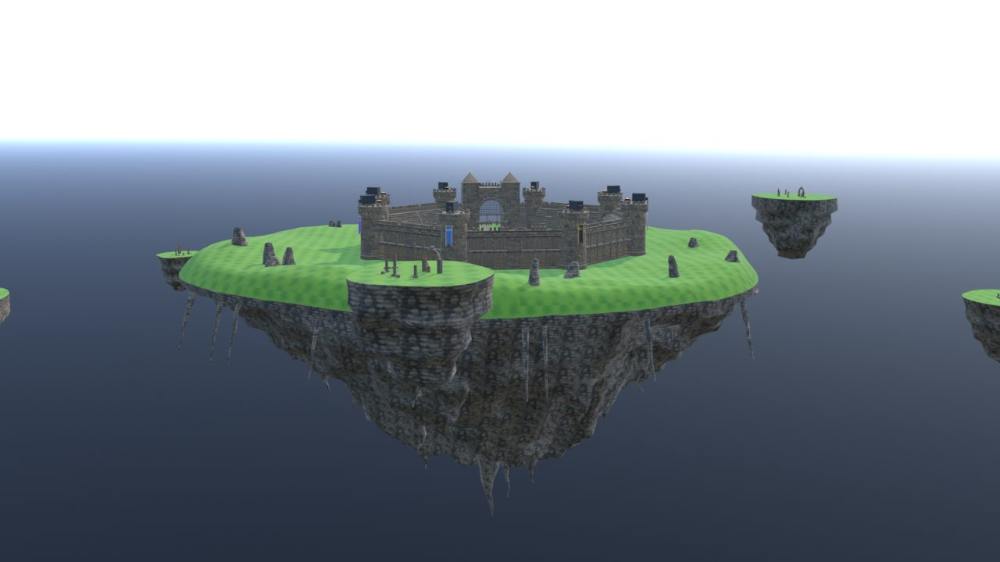
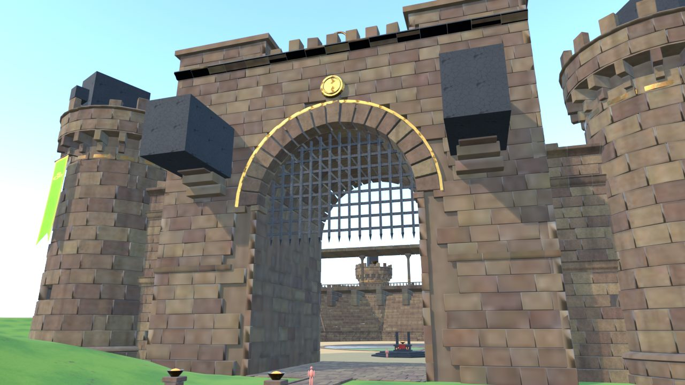
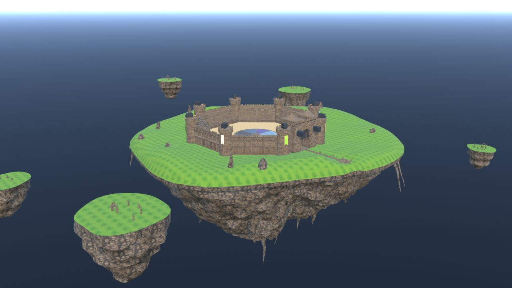
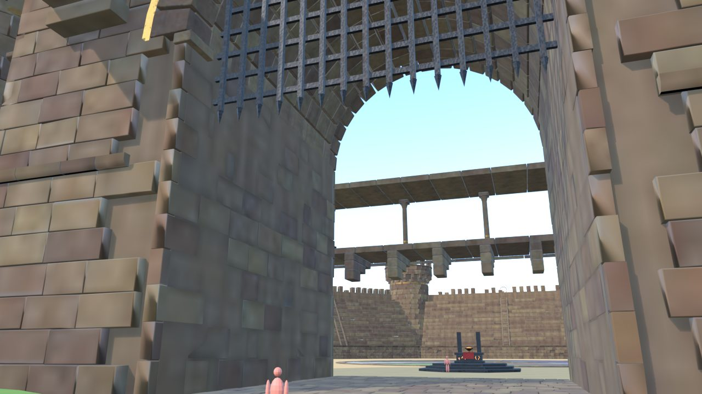
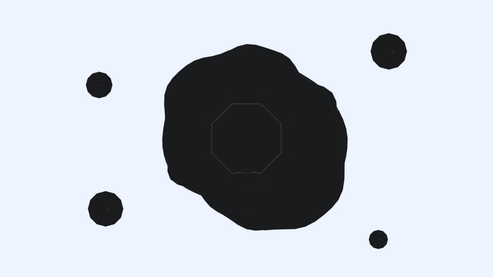
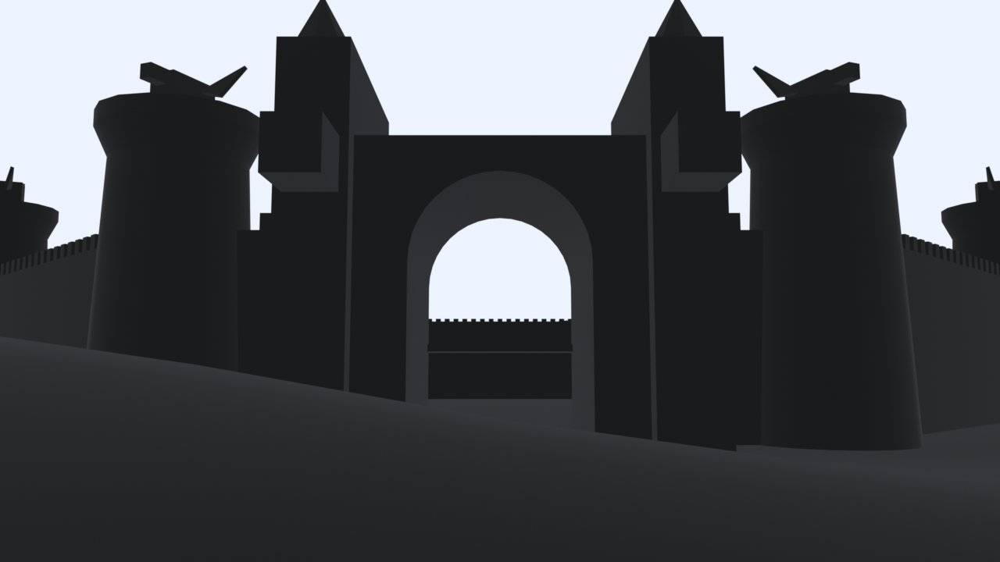
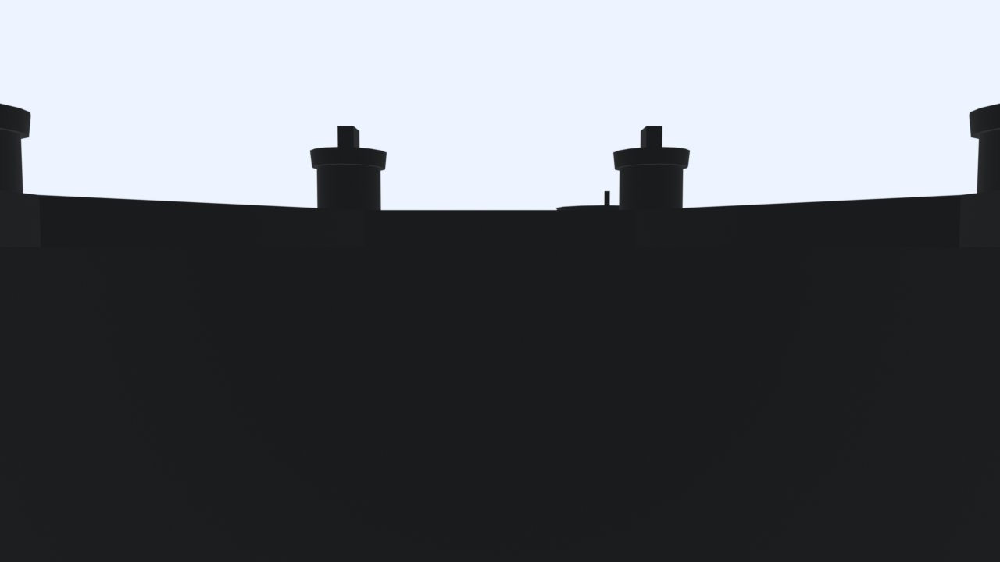
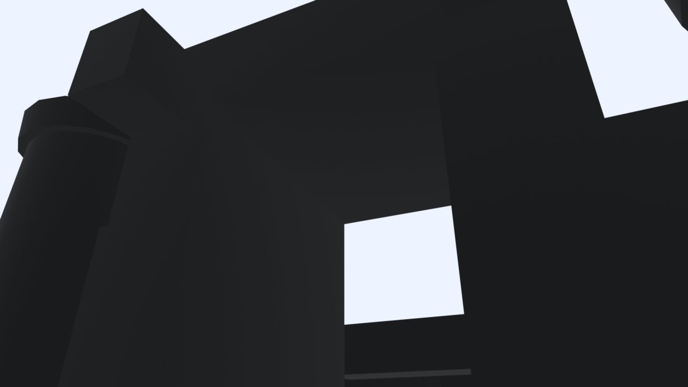
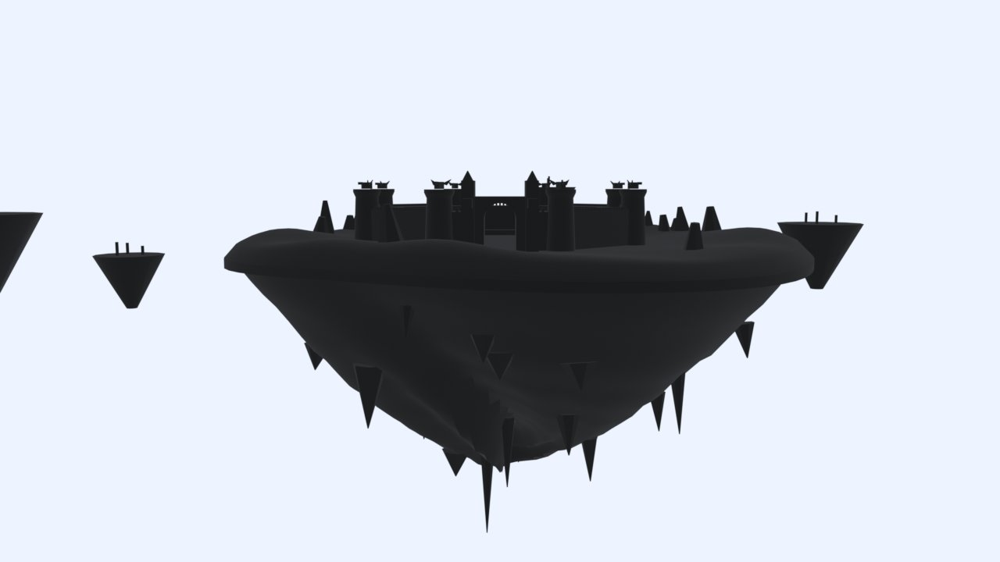
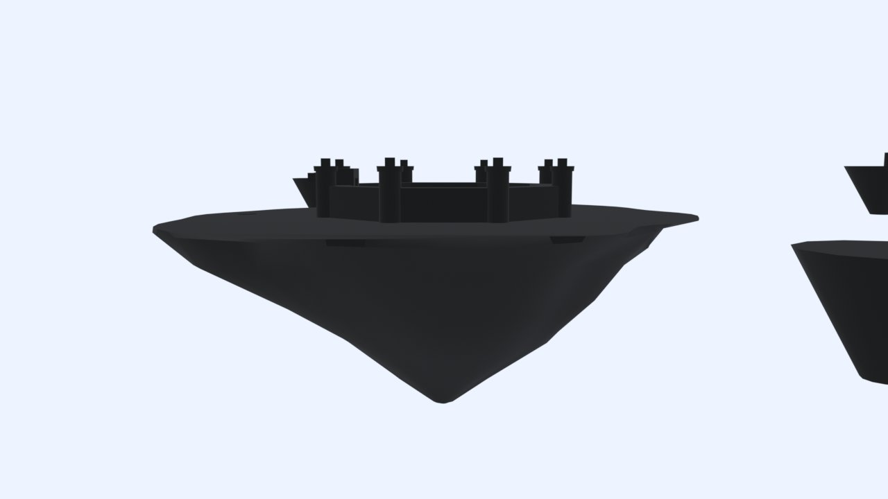
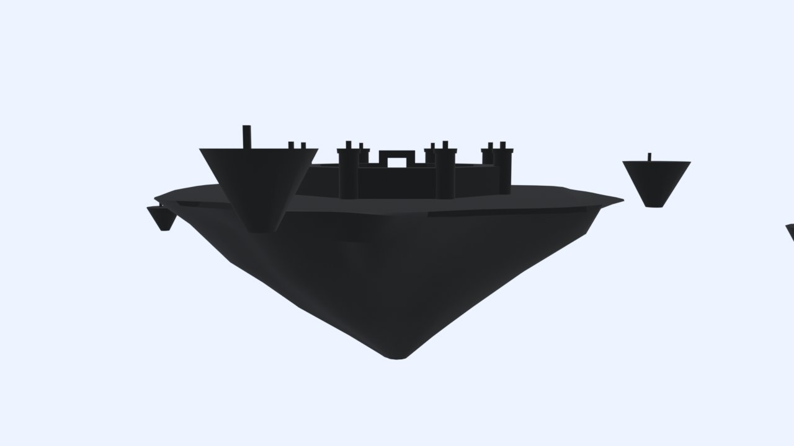
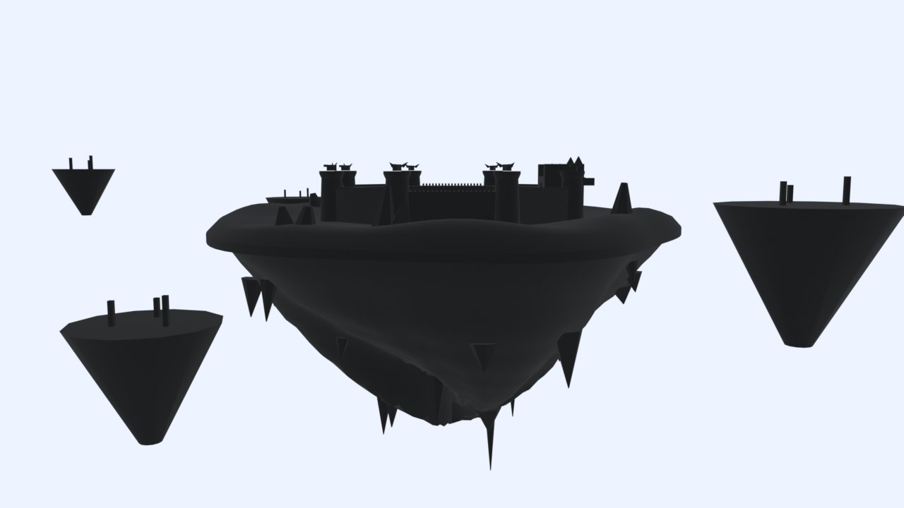
