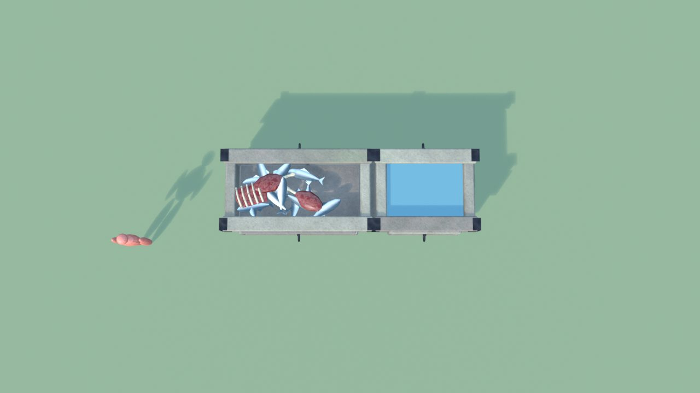
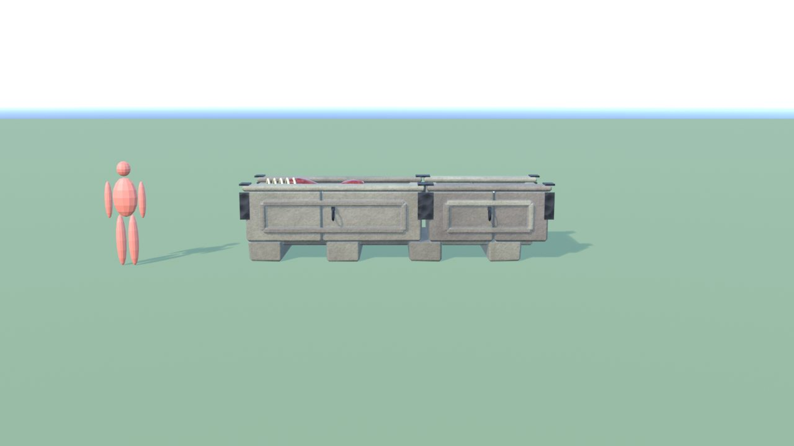
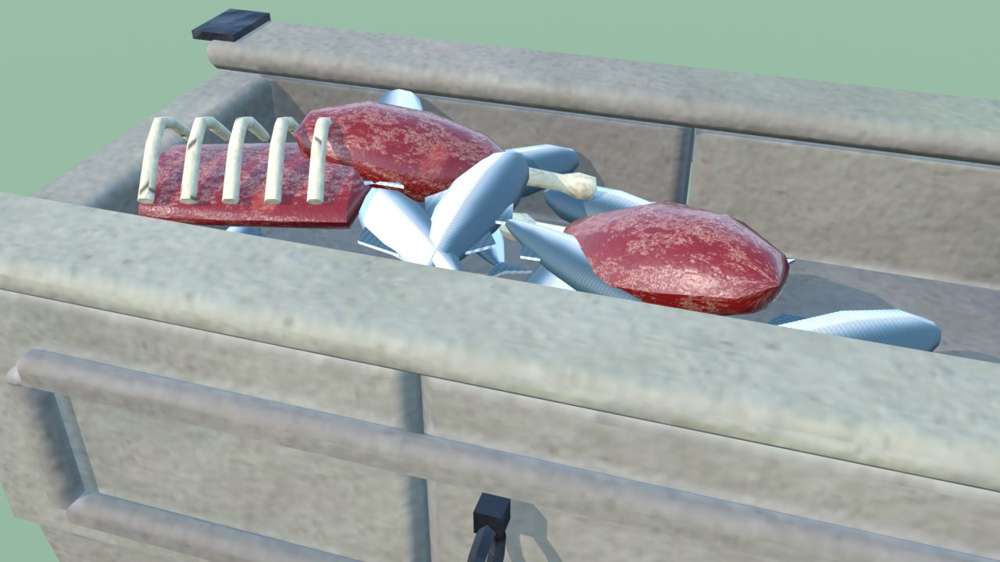
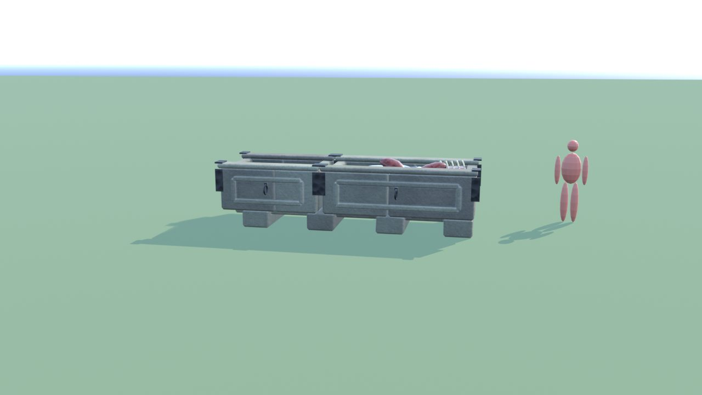
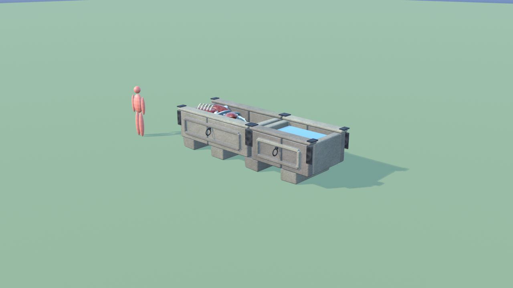
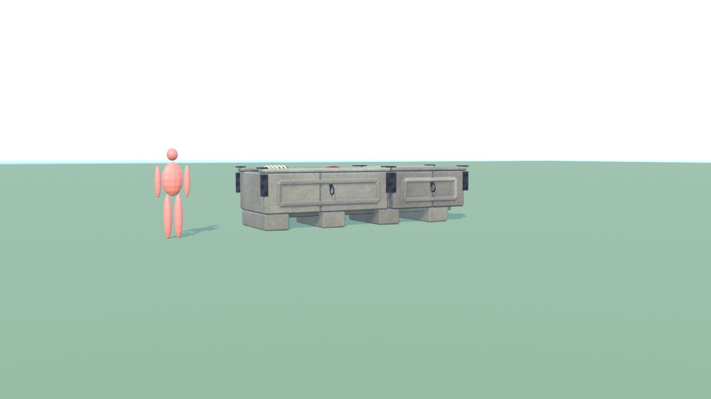

# MangiatoiaDrago - controllo

Ingombro 5.2 x 2.1 x 1.4 m, 5672 triangoli in 7 pezzi (il piu' grande 2072), 1 collisioni, marcatori: FX_Light_Acqua, SPOT_Cibo, SPOT_Acqua.

| Criterio | Voto (1-5) |
|---|---|
| sagoma da lontano | 3 |
| dettagli da vicino | 4 |
| materiali (sporco, usura, colore) | 4 |
| proporzioni col personaggio | 4 |
| qualita' da gioco Roblox | 4 |
| budget (triangoli, misure, collisioni) | 5 |

Sotto 4: da lontano e' una cassa di pietra: si riconosce dal cibo

## Anteprime

