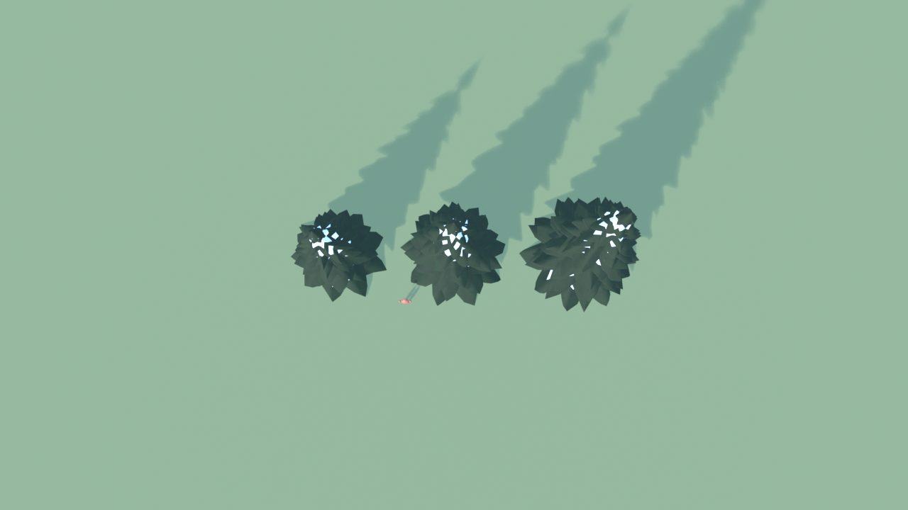
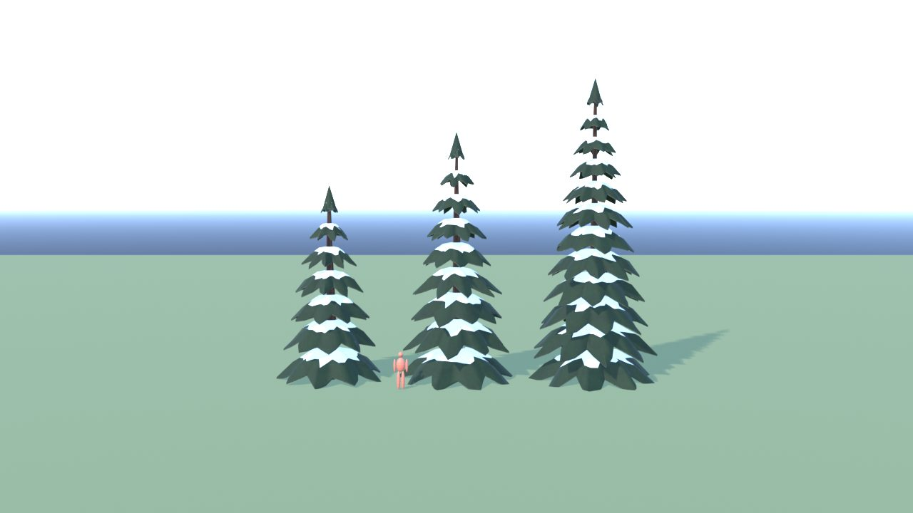
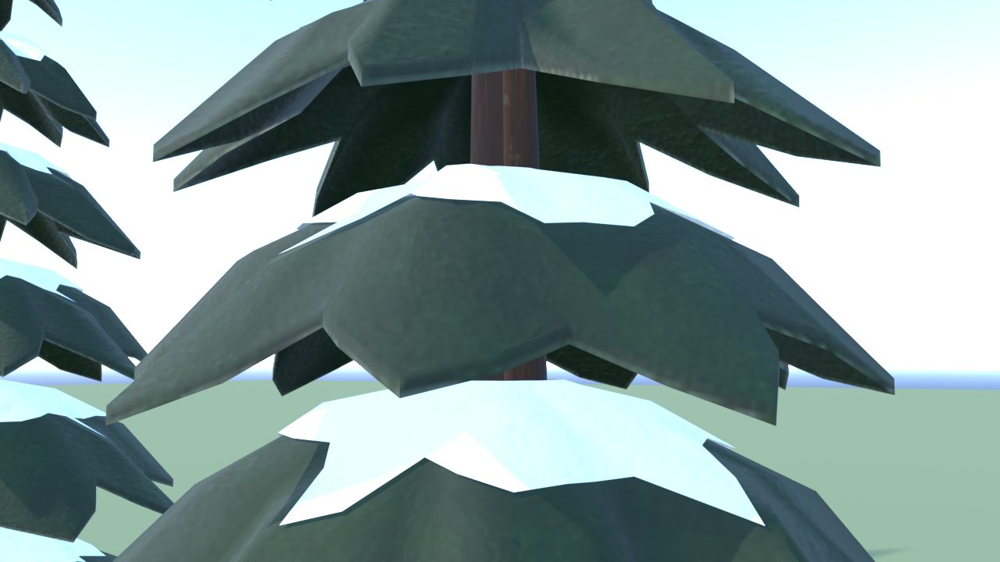
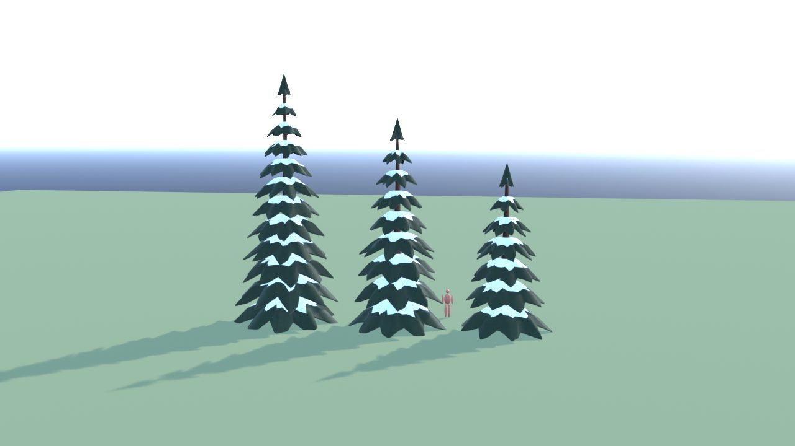
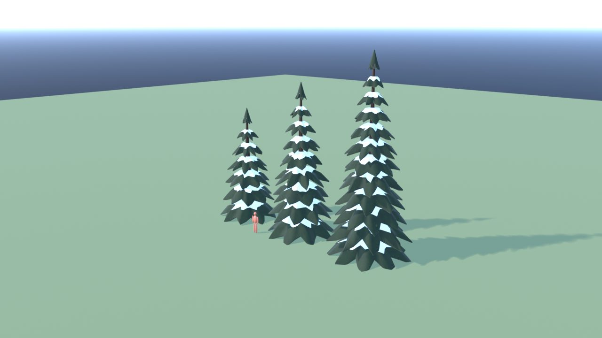
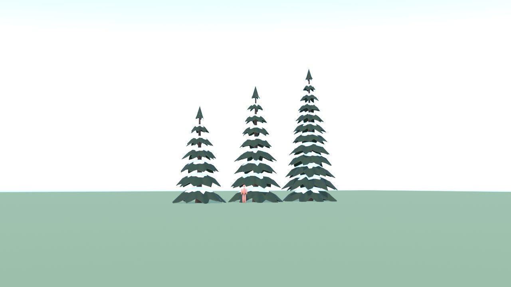

# PinoInnevato - controllo

Ingombro 18.2 x 6.5 x 14.6 m, 17424 triangoli in 9 pezzi (il piu' grande 5736), 6 collisioni, marcatori: SPOT_Pino1, SPOT_Pino2, SPOT_Pino3.

| Criterio | Voto (1-5) |
|---|---|
| sagoma da lontano | 4 |
| dettagli da vicino | 4 |
| materiali (sporco, usura, colore) | 4 |
| proporzioni col personaggio | 5 |
| qualita' da gioco Roblox | 4 |
| budget (triangoli, misure, collisioni) | 5 |

Cosa manca: stile a palchi stilizzato, non realistico

## Anteprime

