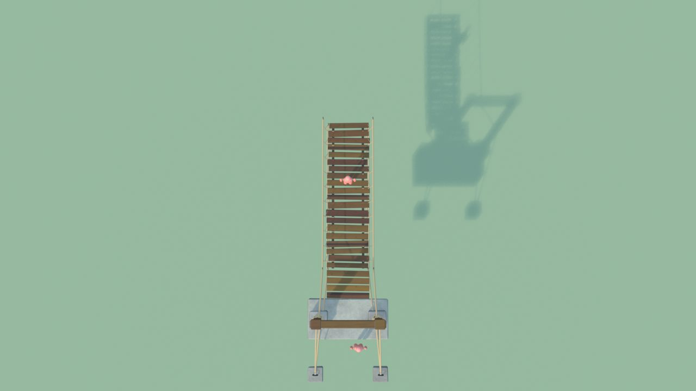
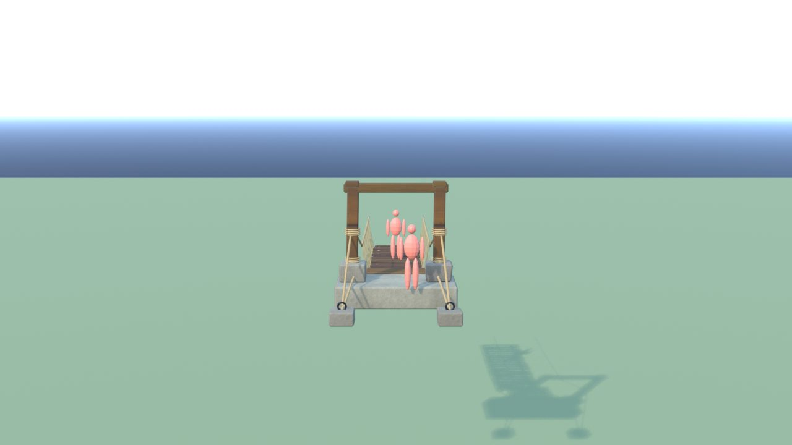
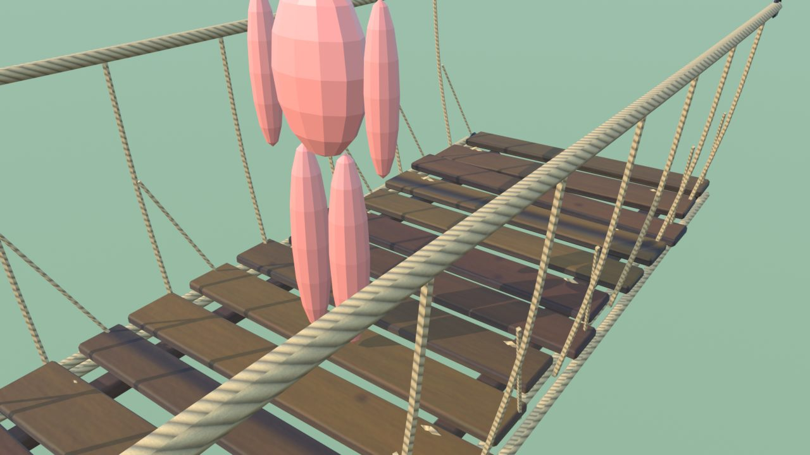
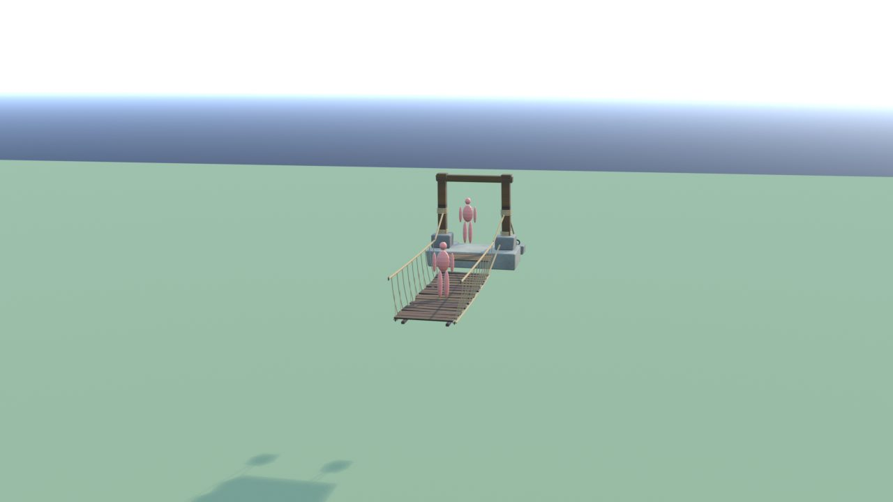
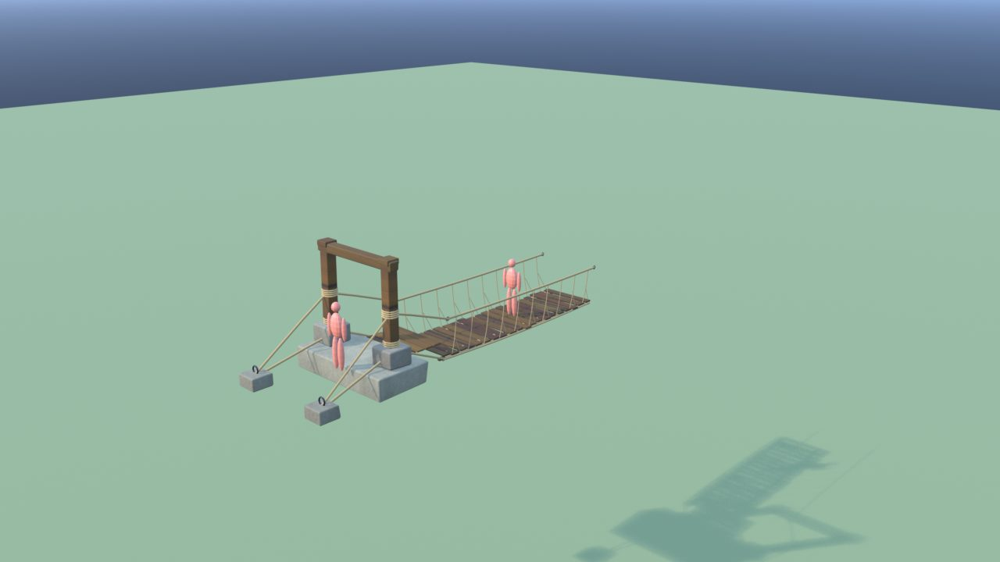
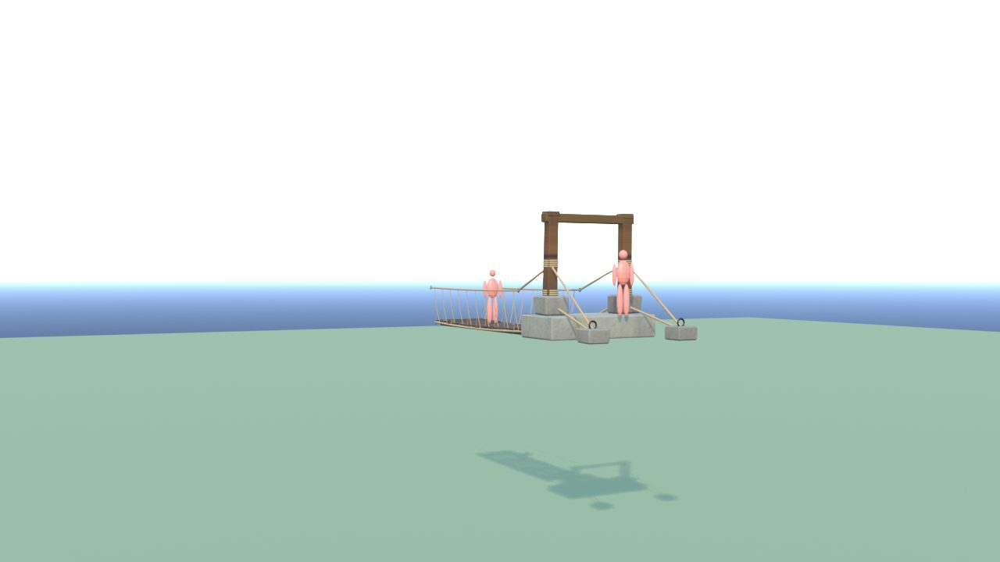

# PonteTibetano - controllo

Ingombro 3.2 x 10.6 x 3.3 m, 8342 triangoli in 7 pezzi (il piu' grande 3960), 6 collisioni, marcatori: SPOT_Inizio, SPOT_Fine.

| Criterio | Voto (1-5) |
|---|---|
| sagoma da lontano | 4 |
| dettagli da vicino | 4 |
| materiali (sporco, usura, colore) | 4 |
| proporzioni col personaggio | 5 |
| qualita' da gioco Roblox | 4 |
| budget (triangoli, misure, collisioni) | 5 |

Cosa manca: niente di grave.

## Anteprime

