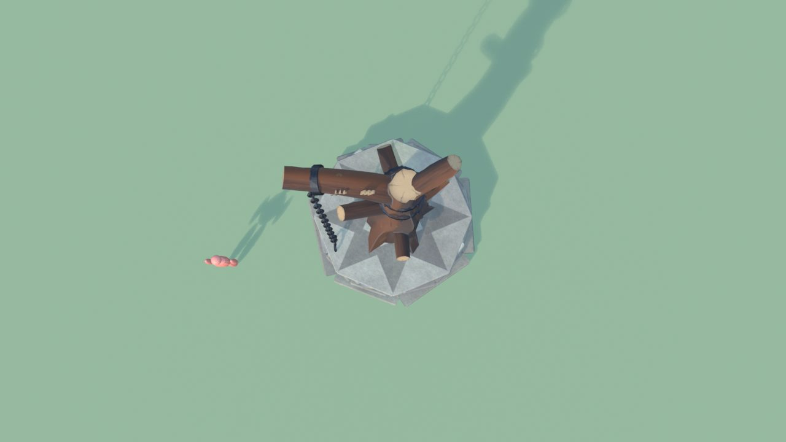
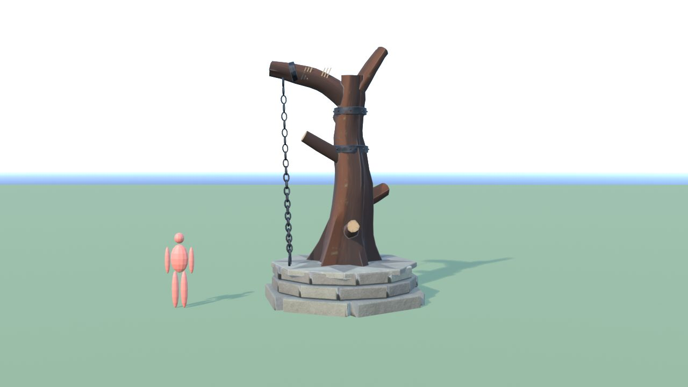
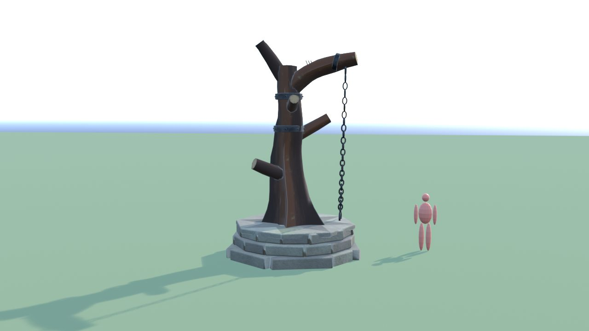
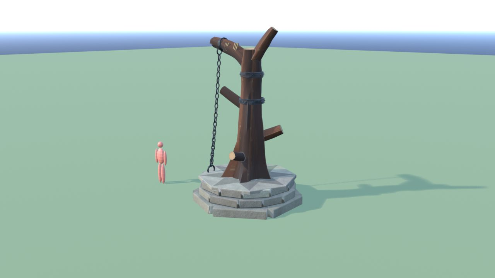
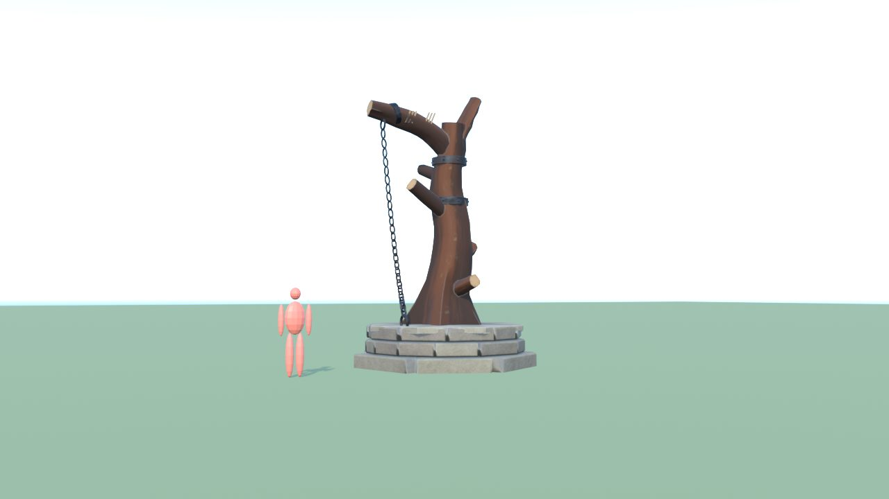

# PosatoioDrago - controllo

Ingombro 3.8 x 3.9 x 6.4 m, 6436 triangoli in 4 pezzi (il piu' grande 3648), 4 collisioni, marcatori: SPOT_Posatoio.

| Criterio | Voto (1-5) |
|---|---|
| sagoma da lontano | 4 |
| dettagli da vicino | 4 |
| materiali (sporco, usura, colore) | 4 |
| proporzioni col personaggio | 4 |
| qualita' da gioco Roblox | 4 |
| budget (triangoli, misure, collisioni) | 5 |

Cosa manca: corteccia ancora un po' liscia: con il tronco Meshy (facoltativo) sarebbe 5

## Anteprime

