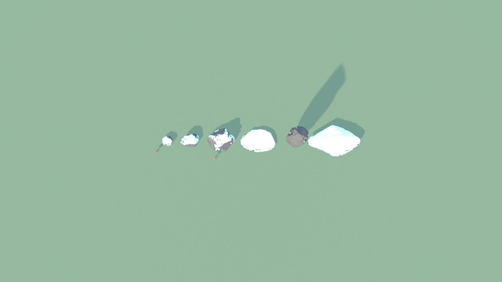
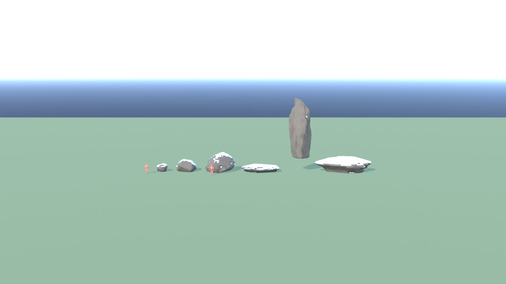
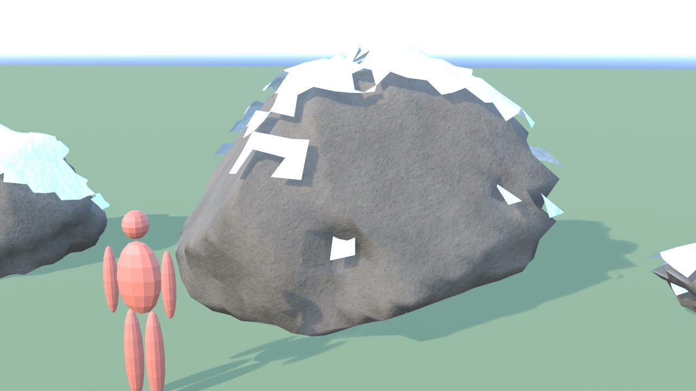
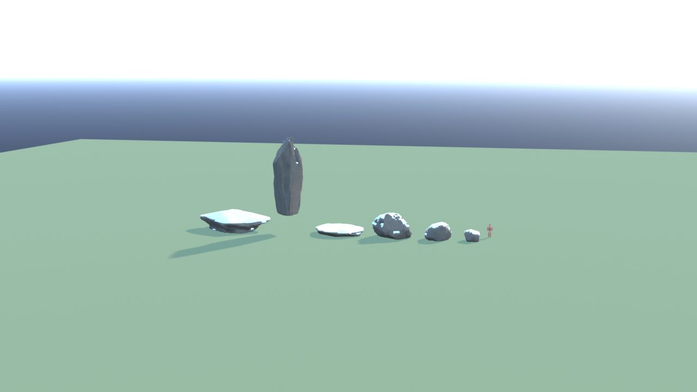
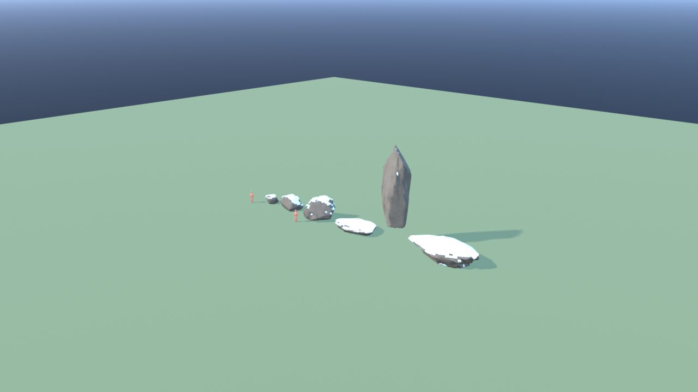
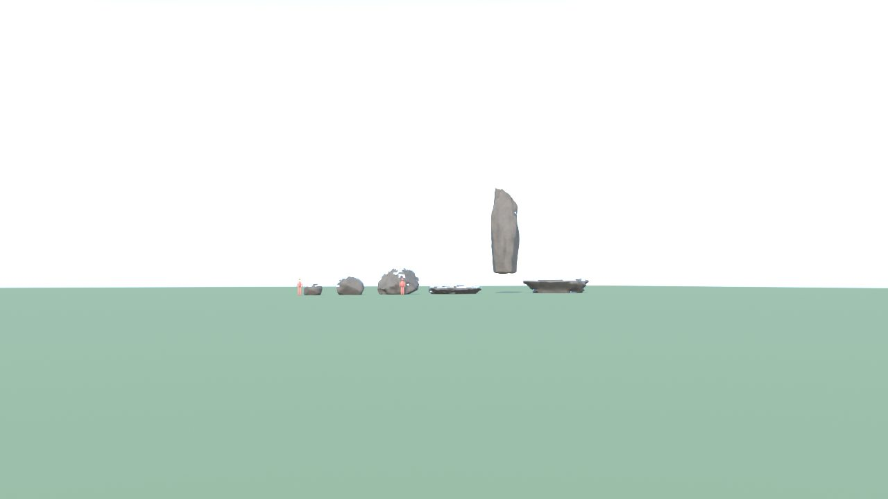

# RocceSet - controllo

Ingombro 35.0 x 5.5 x 12.1 m, 16328 triangoli in 12 pezzi (il piu' grande 2704), 6 collisioni, marcatori: SPOT_Roccia1, SPOT_Roccia2, SPOT_Roccia3, SPOT_Roccia4, SPOT_Roccia5, SPOT_Roccia6.

| Criterio | Voto (1-5) |
|---|---|
| sagoma da lontano | 4 |
| dettagli da vicino | 4 |
| materiali (sporco, usura, colore) | 4 |
| proporzioni col personaggio | 5 |
| qualita' da gioco Roblox | 4 |
| budget (triangoli, misure, collisioni) | 5 |

Cosa manca: niente di grave.

## Anteprime

