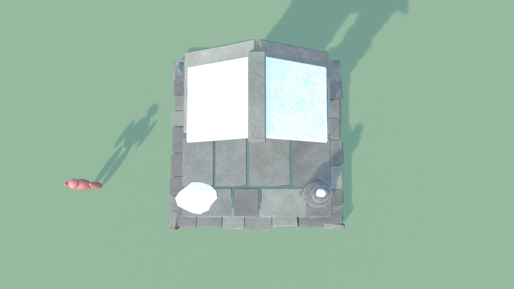
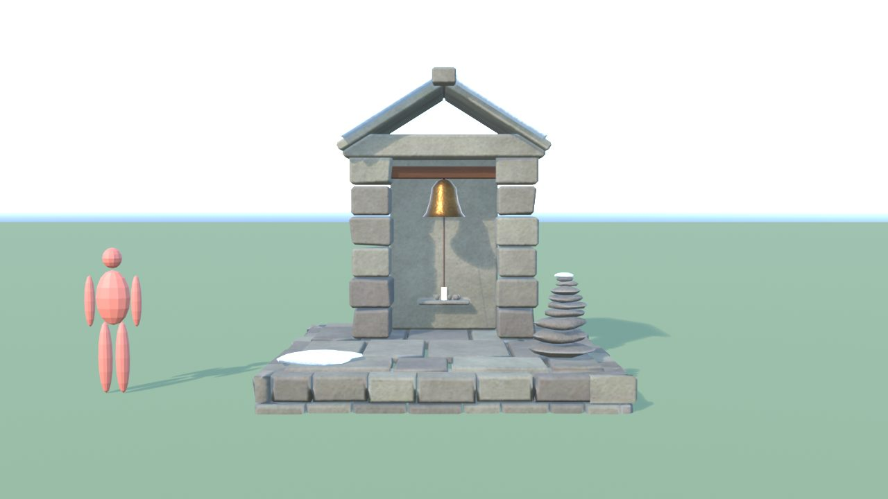
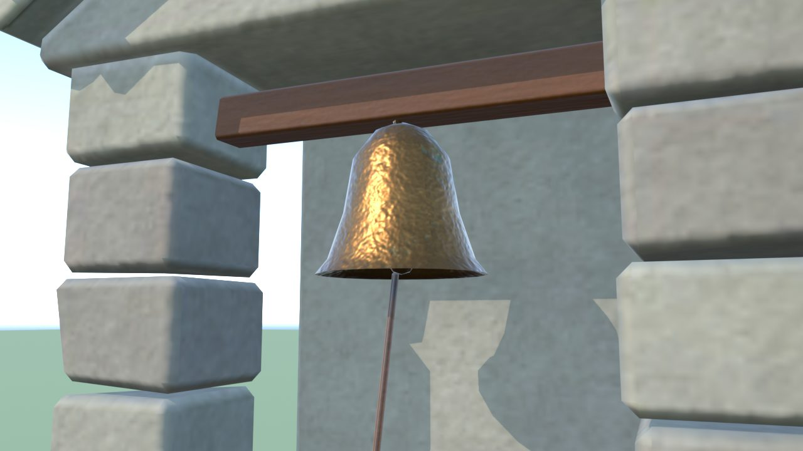
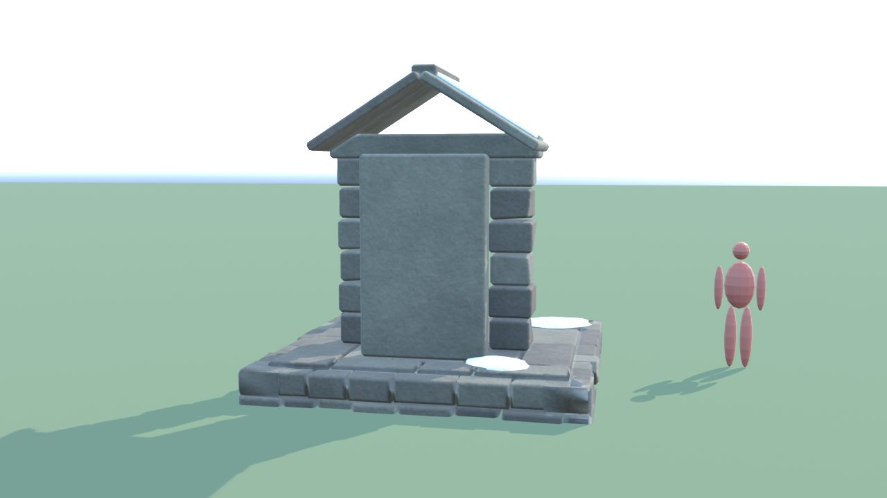
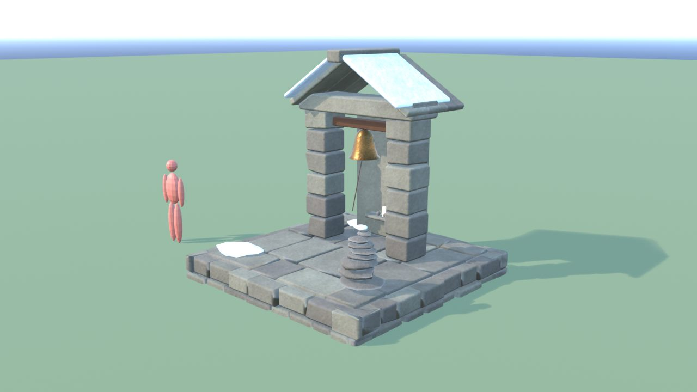
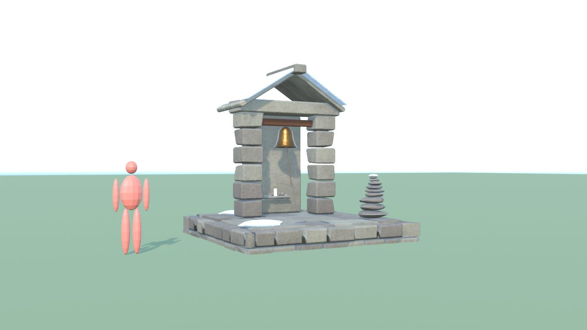

# SantuarioVetta - controllo

Ingombro 4.1 x 4.1 x 4.1 m, 5032 triangoli in 6 pezzi (il piu' grande 2462), 6 collisioni, marcatori: FX_Light_Candela, SPOT_Campana.

| Criterio | Voto (1-5) |
|---|---|
| sagoma da lontano | 4 |
| dettagli da vicino | 4 |
| materiali (sporco, usura, colore) | 4 |
| proporzioni col personaggio | 4 |
| qualita' da gioco Roblox | 4 |
| budget (triangoli, misure, collisioni) | 5 |

Cosa manca: ometto di sassi un po' regolare

## Anteprime

