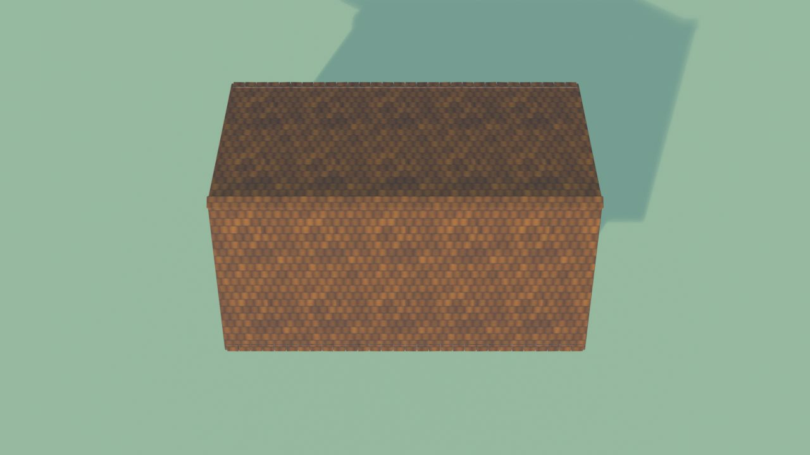
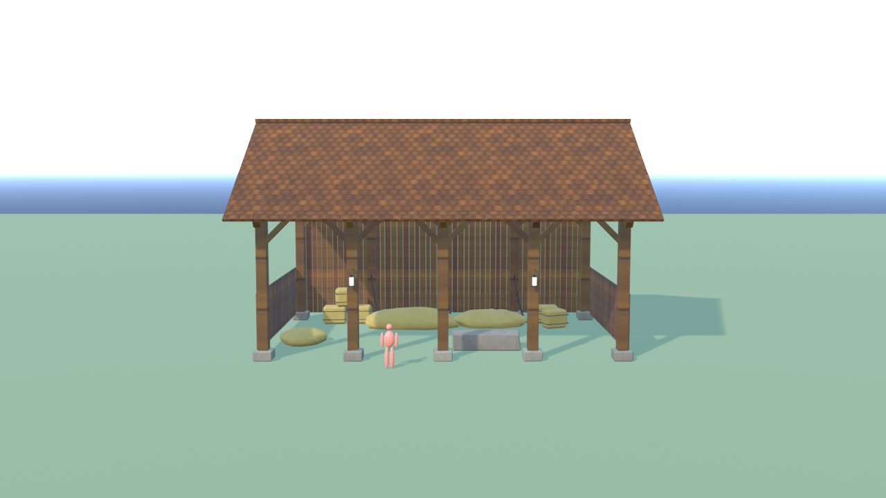
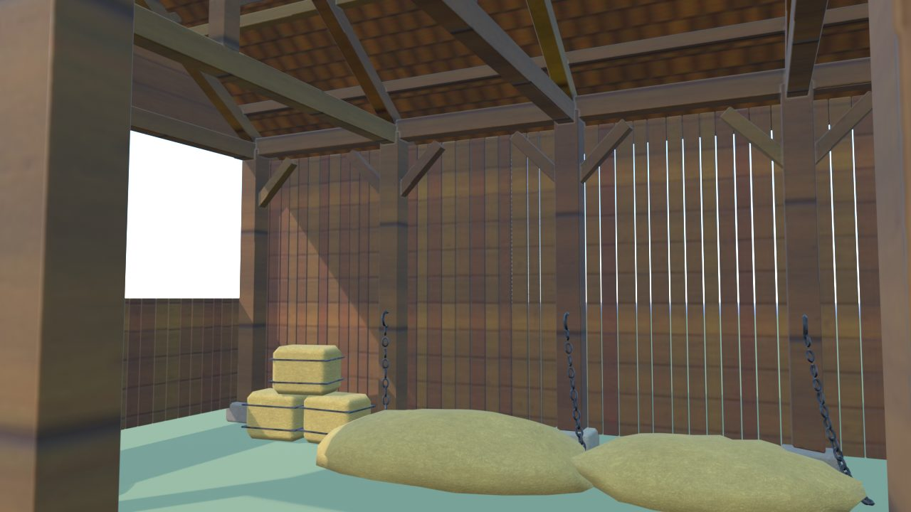
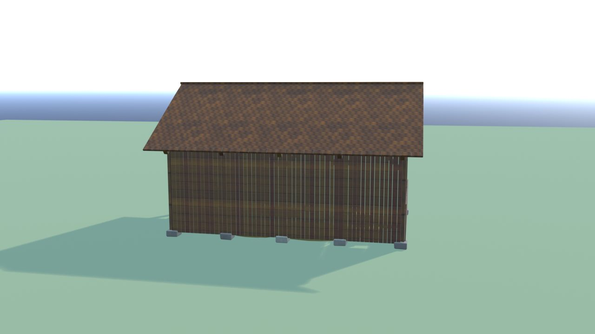
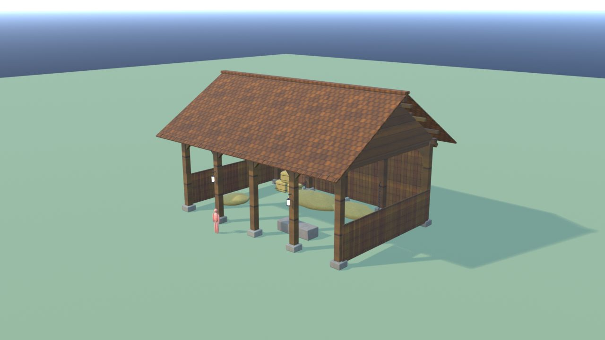
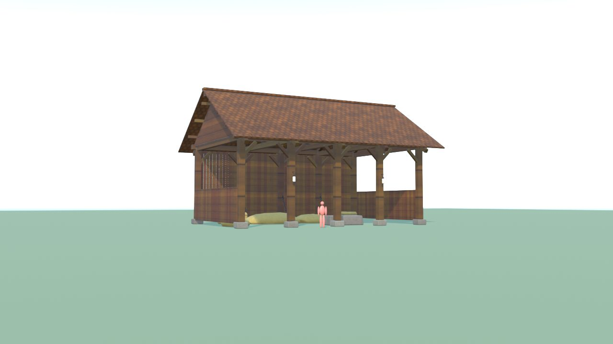

# StallaDraghi - controllo

Ingombro 16.2 x 12.4 x 9.8 m, 16968 triangoli in 7 pezzi (il piu' grande 5976), 15 collisioni, marcatori: FX_Light_Stalla1, FX_Light_Stalla2, SPOT_Drago.

| Criterio | Voto (1-5) |
|---|---|
| sagoma da lontano | 4 |
| dettagli da vicino | 4 |
| materiali (sporco, usura, colore) | 4 |
| proporzioni col personaggio | 5 |
| qualita' da gioco Roblox | 4 |
| budget (triangoli, misure, collisioni) | 5 |

Cosa manca: niente di grave.

## Anteprime

