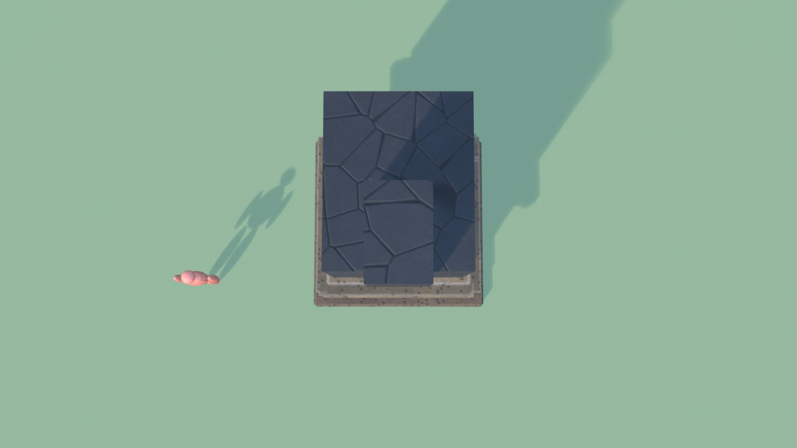
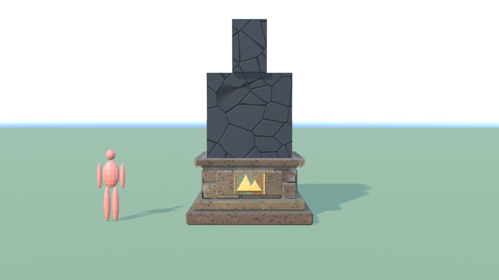
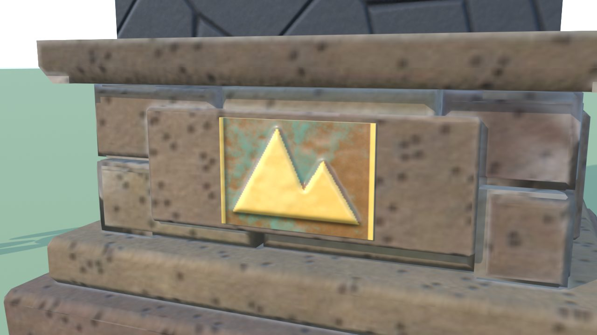
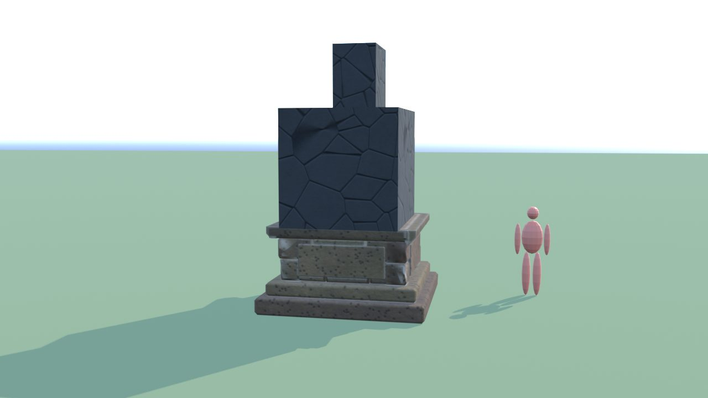
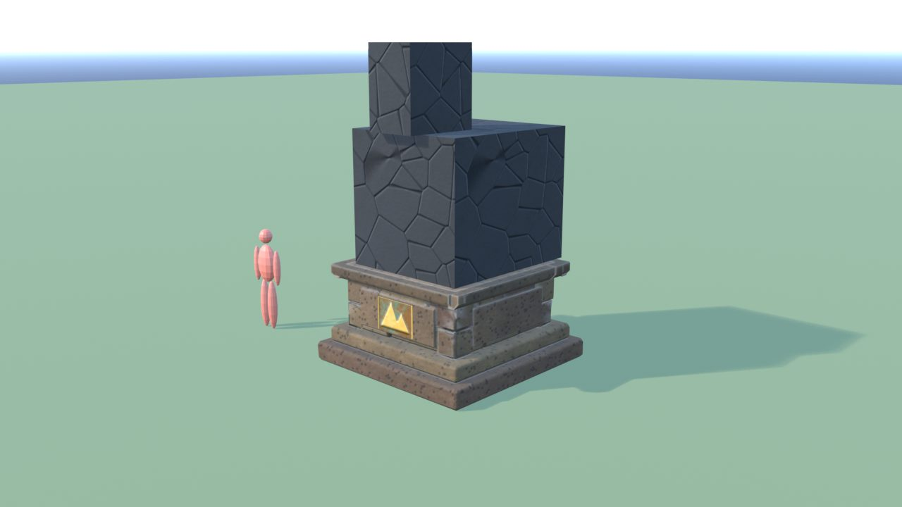
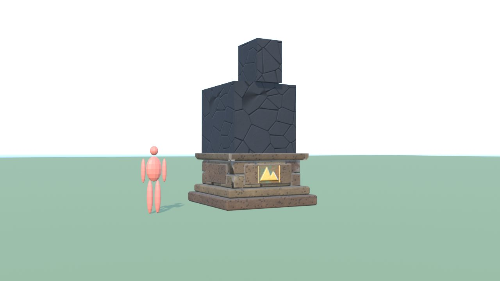

# StatuaDrago - controllo

Ingombro 2.9 x 2.9 x 4.7 m, 928 triangoli in 10 pezzi (il piu' grande 824), 1 collisioni, marcatori: SPOT_Statua.

| Criterio | Voto (1-5) |
|---|---|
| sagoma da lontano | 3 |
| dettagli da vicino | 4 |
| materiali (sporco, usura, colore) | 4 |
| proporzioni col personaggio | 4 |
| qualita' da gioco Roblox | 3 |
| budget (triangoli, misure, collisioni) | 5 |

Sotto 4: la statua e' Meshy (segnaposto); qui solo piedistallo e targhe

Segnaposto (Meshy, vedi MESHY_PROMPT.md): PLACEHOLDER_StatuaDrago

## Anteprime

