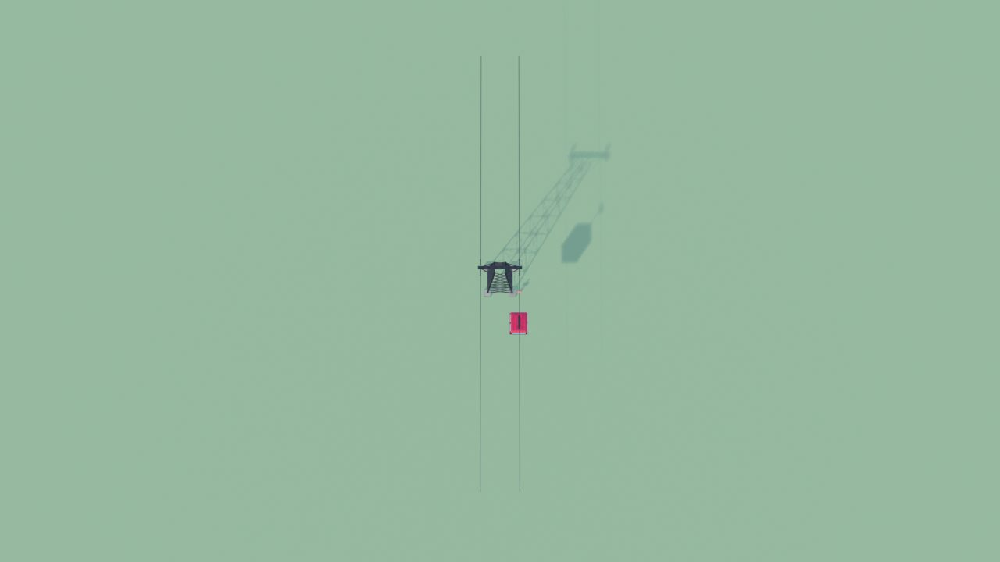
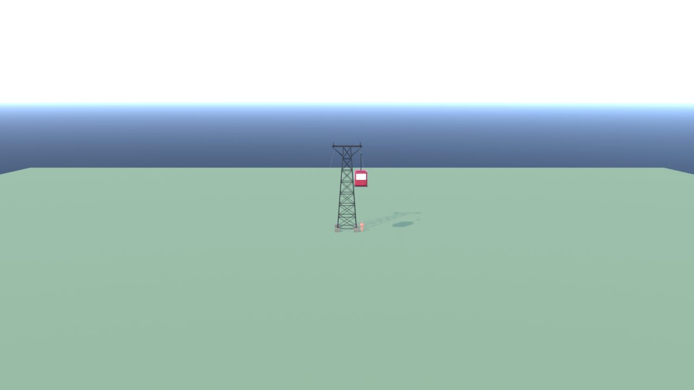
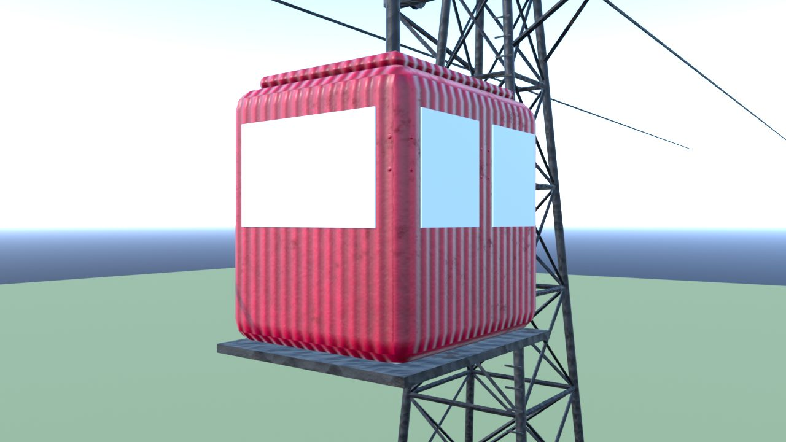
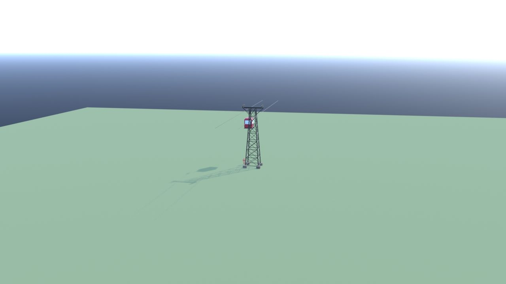
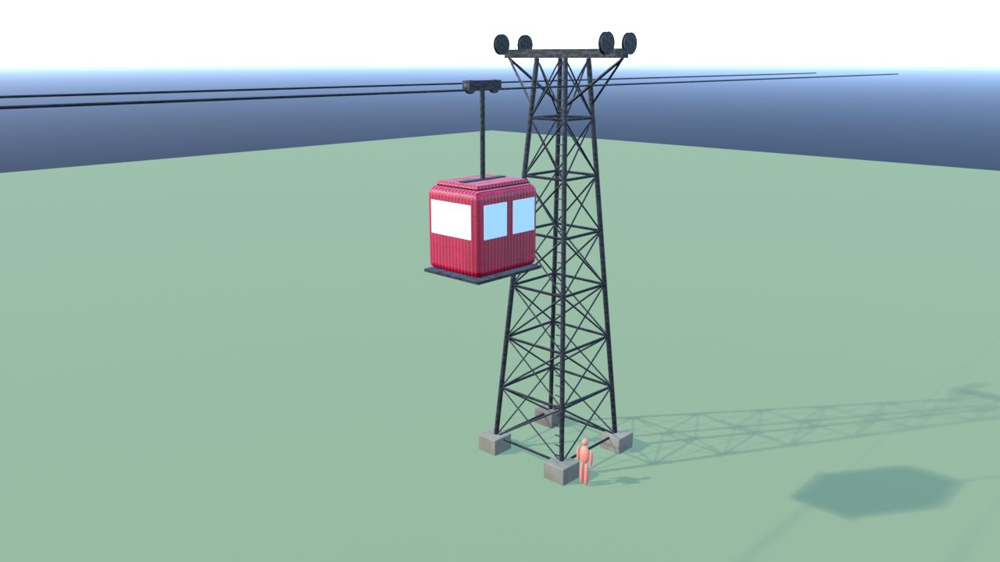
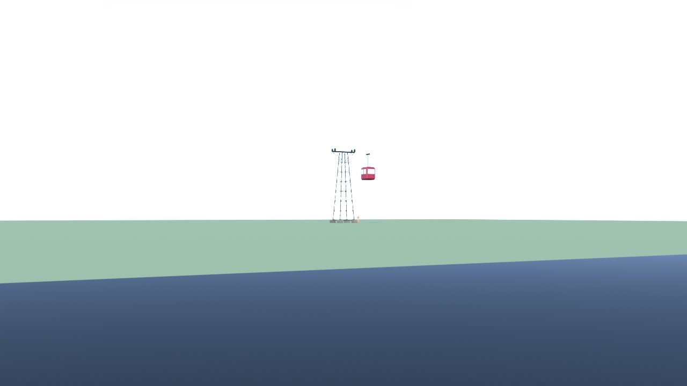

# Teleferica - controllo

Ingombro 5.8 x 50.0 x 14.9 m, 2972 triangoli in 4 pezzi (il piu' grande 2436), 2 collisioni, marcatori: SPOT_Cabina.

| Criterio | Voto (1-5) |
|---|---|
| sagoma da lontano | 5 |
| dettagli da vicino | 4 |
| materiali (sporco, usura, colore) | 4 |
| proporzioni col personaggio | 5 |
| qualita' da gioco Roblox | 4 |
| budget (triangoli, misure, collisioni) | 5 |

Cosa manca: le funi sono lunghe 50 m: in Studio vanno allungate fra due piloni

## Anteprime

